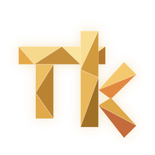

<p align="center"></p>

# pi-kit

A desktop UI for the [pi](https://pi.dev) coding agent, in the spirit of Claude Code's desktop app:
Angular + daisyUI in the renderer, NestJS in the main-process backend, packaged with Electron.
The frontend and backend talk [AG-UI](https://docs.ag-ui.com) through the open-source
CopilotKit runtime, which gives us generative UI (A2UI), MCP Apps and human-in-the-loop for free.

## Where things are

| Path | What |
|---|---|
| `doc/` | The documentation site (Docusaurus): `cd doc && pnpm install && pnpm start`. Start with its Architecture page. |
| `doc/docs/architecture.md` | How the three processes, pi and the stores fit together, with diagrams. |
| `doc/docs/backend.md` | The backend's domain folders, the request path, and the steps for a new route, domain, table or stream. |
| `doc/docs/agui-events.md` | The AG-UI event pipeline: runs, events, replay, interrupts, and a review. |
| `doc/docs/background-agents.md` | Background agents (subagents): how they are spawned, run, report back and are shown. |
| `doc/docs/adr/` | Architecture decision records. Read before changing a decision. |
| `doc/docs/structure.md` | The repo tree, the library tags and the one-line rule per library type, the domain-lib generator. |
| `doc/docs/design-system.md` | Tokens, type, spacing, layout, components. The look of the app in one page. |
| `doc/docs/plugins.md` | The `pi-kit:*` event contract the pi packages that ship with the app use. |
| `doc/api/openapi.yaml` | The backend's HTTP contract, regenerated by `pnpm run api:openapi`. |
| `examples/` | A pi extension that returns an A2UI surface and an MCP server that ships an MCP App, with how to run them. |

## Install

A release lists these files (the draft GitHub release the `release` workflow makes, or `dist/release/` after `pnpm run release`):

| File | For |
|---|---|
| `pi-kit-<version>-mac-arm64.dmg` | macOS on Apple Silicon: open it and drag pi-kit to Applications |
| `pi-kit-<version>-mac-arm64.zip` | the same app zipped; this is what the in-app update installs from |
| `pi-kit-<version>-win-x64.exe` | Windows on Intel/AMD: the installer (per user, you choose the folder) |
| `pi-kit-<version>-win-x64-portable.exe` | Windows on Intel/AMD: one file, no installation |
| `pi-kit-<version>-win-arm64.exe`, `-win-arm64-portable.exe` | the same for Windows on ARM |
| `pi-kit-<version>-linux-x86_64.AppImage` | Linux on Intel/AMD (x64): make executable (`chmod +x`) and run |
| `pi-kit-<version>-linux-arm64.AppImage` | Linux on ARM64: make executable (`chmod +x`) and run |
| `latest-mac.yml`, `latest.yml`, `latest-linux*.yml`, `*.blockmap` | the update feed of the in-app updater; not for people |

Builds are unsigned unless the release was made with signing credentials: macOS asks you to allow an ad-hoc signed app in System Settings › Privacy & Security (a notarized build opens normally),
Touch ID storage additionally requires a signed macOS build with Keychain Sharing; development builds can stay on the macOS no-store default, or explicitly use `PI_KIT_SECRET_STORE=legacy` for the old keyring (see Packaging). Windows SmartScreen warns about an unsigned installer. The Windows builds have been built and their natives checked on a Mac; none has been started on Windows yet.

**Build a release:** `pnpm run release` writes to `dist/release/`: macOS and Windows targets on a Mac, or the host's Linux architecture on Linux. Select a target with `--only mac|win|win-x64|win-arm64|linux|linux-x64|linux-arm64`. `node scripts/release-smoke.mjs dist/release/pi-kit-<version>-mac-arm64.zip` launches the result against a scratch pi folder and a local fake model. Tag `v<version>` to let `.github/workflows/release.yml` build on macOS, Windows and native Linux x64/ARM64 runners and draft the GitHub release. A manual workflow run builds artifacts without creating a release.

## Run it

Node 24 and pnpm 11 (`corepack enable` picks the exact version, `packageManager` in `package.json`; [ADR-0009](doc/docs/adr/0009-build-and-dev-tooling.md)). `pnpm install --frozen-lockfile` once (it links the hoisted `node_modules` from pnpm's shared store, so an install in a new worktree takes seconds; `pnpm-workspace.yaml` holds the `allowBuilds` list and `nodeLinker: hoisted`; `package-lock.json` must not come back), then:

| Command | What |
|---|---|
| `pnpm run dev` | Electron window: renderer dev server on an OS-assigned port (override with `PI_KIT_DEV_RENDERER_PORT`), backend watch build, Electron main spawns the backend on a random port with a random token and restarts it if it crashes. A development build has a profile of its own (`.pi-kit-data-desktop/`, or `PI_KIT_DATA_DIR`) with its own storage settings: Touch ID and the installed app's data belong to the signed app |
| `pnpm run dev:web` | Backend on `127.0.0.1:4300` and renderer on `http://localhost:4200` for a normal browser; the token reaches the browser through a dev-only endpoint |
| `pnpm run check` | Translation, Angular formatting and icon checks, the tooling tests, lint and hook checks, then `nx run-many -t build eslint:lint test` and the OpenAPI document and typed client compared with the committed ones. `CHECK_E2E=1 pnpm run check` adds the end-to-end tests |
| `pnpm run e2e` | Playwright tests against `dev:web` with pi and a local model, in a scratch pi folder and git project (below) |
| `pnpm run release` | Packs macOS and Windows on a Mac, or the native Linux target on Linux, into `dist/release/`. `--only mac\|win\|win-x64\|win-arm64\|linux\|linux-x64\|linux-arm64`, `--dir` for unpacked apps. `package:mac`, `package:win` and `package:linux` select the platform; `package:linux:docker` builds a Linux target on a Mac in a Docker container |
| `pnpm run release:smoke <zip\|dmg\|AppImage\|app folder>` | Launches a packed build against a scratch pi folder and a local fake model, sends one prompt, quits (`scripts/release-smoke.mjs`) |
| `pnpm run screenshots` | Playwright screenshots of the running `dev:web` app, one named scene at a time (`--list`, `--set bg-agents --serve --out <dir>`); needs `pnpm exec playwright install chromium` once |

### Packaging

`pnpm run release` (or `package:mac`, its alias for the macOS part) runs the production builds, stages `dist/package/` (the Electron shell and renderer for `app.asar`) and `dist/stage/<platform>-<arch>/backend`
(the NestJS backend and that target's native modules, as the plain folder `Resources/backend`) and calls electron-builder. Nx uses esbuild to bundle, tree-shake and minify the backend's JavaScript, including Nest and CopilotKit; TypeScript emits the decorator metadata Nest needs before bundling. The `backend-runtime` Nx project bundles the Pi SDK, MCP, Needle and native-module JavaScript loaders with esbuild as well. Runtime workers are explicit entrypoints; WASM, themes and other data are declared Nx assets. Staging consumes production `dist` artifacts, selects the target's native binaries and adds the self-contained macOS `keychain-store` loader; it never traverses or copies a JavaScript dependency tree from `node_modules`. The shell includes the splash HTML and icon. The app starts that backend with
`ELECTRON_RUN_AS_NODE` and serves the renderer from `app://pi-kit/`. Without a Developer ID certificate the app is ad-hoc signed. Touch ID credential storage requires an Apple-signed app with Keychain Sharing; an ad-hoc development build can keep storage disabled or explicitly select `PI_KIT_SECRET_STORE=legacy` for the old keyring. For a signed release set `CSC_NAME` (or `CSC_LINK` and `CSC_KEY_PASSWORD`), `APPLE_TEAM_ID` and `PI_KIT_MAC_PROVISIONING_PROFILE` (a provisioning profile for `dev.pi-kit.app` allowing `TEAMID.dev.pi-kit.app` as a Keychain access group). To notarize, also set `PI_KIT_NOTARIZE=1` with
`APPLE_KEYCHAIN_PROFILE` (credentials saved by `xcrun notarytool store-credentials`), `APPLE_ID` + `APPLE_APP_SPECIFIC_PASSWORD` + `APPLE_TEAM_ID`, or `APPLE_API_KEY` + `APPLE_API_KEY_ID` + `APPLE_API_ISSUER`. Requested notarization fails the build when signing or authentication is missing. The build notarizes and staples the app before creating the ZIP, then signs, notarizes and staples the DMG. If a temporary network failure interrupts a status request after upload, the build resumes that submission for up to five minutes without uploading it again; acceptance and stapling must still succeed. Gatekeeper and ticket checks must pass; DMG blockmaps and update checksums are refreshed after stapling. Windows signing is `WIN_CSC_LINK` and `WIN_CSC_KEY_PASSWORD`. `pnpm run release --only mac --dir` stops at the unpacked
`dist/release/mac-arm64/pi-kit.app`, which can be started from a terminal: `pi-kit.app/Contents/MacOS/pi-kit --remote-debugging-port=9333` makes the window reachable
from Playwright (`chromium.connectOverCDP`), and the app's log is `~/Library/Logs/pi-kit/{main,backend}.log` (it names the backend's port and process id).
A fresh macOS profile starts without credential storage or database encryption, even in a signed build: startup does not load or query Keychain. Opt in with the credential-storage toggle in Settings › Advanced › Security (see below); signing alone does not authorize migration. Existing keys and resolver configurations are not automatically migrated on startup. Existing encrypted app/background-agent data still requires its original key to unlock, even after opting out; cancellation or unlock failure retains the encrypted data and key, never resets the database, and never silently switches it to plaintext. OAuth credentials stay managed by pi. In Settings › Advanced, install `pi-kit-secret` on PATH for the standalone pi CLI. Native-store launchers embed the explicit `macos` or `legacy` store choice, so the terminal does not need to inherit the app environment. Each real CLI credential read can request Touch ID; opening Settings does not read secrets. CI signing additionally needs `MAC_PROVISIONING_PROFILE_BASE64` (the profile encoded as base64) and `APPLE_TEAM_ID` alongside the certificate secrets.

For local notarization, create an app-specific password in your Apple Account, then run the command below. `notarytool` prompts for the password and validates it before saving it in Keychain; keep it out of source files and shell history. With the signing variables above configured, subsequent builds use that profile:

```sh
xcrun notarytool store-credentials pi-kit-notarization --apple-id '<Apple Account email>' --team-id '<Team ID>'
export APPLE_KEYCHAIN_PROFILE=pi-kit-notarization
export PI_KIT_NOTARIZE=1
pnpm run release --only mac
```

The Windows installers can be built on the Mac too (electron-builder's beta toolsets, no Wine). Linux builds require a matching Linux CPU because `node-pty` compiles from source during `pnpm install`; cross builds fail before staging. The release workflow uses Ubuntu 22.04 x64 and ARM64 runners, packages one AppImage per CPU, and smoke-tests each artifact under Xvfb after extracting it without FUSE. It uploads `latest-linux.yml` for x64 and `latest-linux-arm64.yml` for ARM64, as expected by electron-updater.

On an Ubuntu 22.04 Linux build host:

```sh
sudo apt-get update
sudo apt-get install -y build-essential python3 libgtk-3-0 libnss3 libasound2 libgbm1 libsecret-1-0 libxtst6 libxss1 xvfb xauth
pnpm install --frozen-lockfile
pnpm run package:linux  # builds the host architecture; explicit --only linux-x64 / linux-arm64 also works with release
xvfb-run -a node scripts/release-smoke.mjs dist/release/pi-kit-*-linux-*.AppImage
```

Build each architecture on its matching host, or from a Mac in a Linux container:

```sh
pnpm run package:linux:docker                  # the Mac's CPU (arm64 on Apple Silicon), natively in Docker
pnpm run package:linux:docker -- --arch x64    # the other CPU, under Docker's emulation (slower)
pnpm run package:linux:docker -- --smoke       # also smoke-tests the AppImage under Xvfb, as the workflow does
```

`scripts/release-linux-docker.mjs` needs Docker Desktop. It builds an image with what the workflow's runner installs (once per CPU), copies the working tree into a volume that keeps the container's install and build output between runs (`--fresh` drops it), runs `pnpm run release --only linux-<arch>` there and copies the AppImage and `latest-linux*.yml` into `dist/release/`; `--dir` copies the unpacked app instead, `--shell` opens a bash in the container. The `linux` alias selects the host CPU; it does not cross-compile both CPUs. End users need a graphical Linux session, the Electron runtime libraries and a Secret Service provider for credential storage. The default AppImage runtime also needs FUSE 2 (`libfuse2` on Ubuntu 22.04).

Signing must be configured once on each Mac: Git does not transfer private keys, Keychain entries or `.env.mac-signing.local`. Copy the `developer-id-cirgzuda` signing backup to that Mac, then run from the repository:

```sh
pnpm mac:signing:setup "$HOME/Documents/developer-id-cirgzuda"
pnpm package:mac:signed
```

Setup imports the identity into a dedicated keychain, validates and saves notarization credentials there, copies the provisioning profile to `~/.config/pi-kit/signing`, and writes the Git-ignored `.env.mac-signing.local`. It accepts the backup folder's `setup.json`, macOS-compatible `developer-id-application.p12`, `certificate-export-password.txt`, `pi-kit.provisionprofile` and `notarization-password.txt`. Existing signing keychains are reused. The backup folder is no longer needed for builds after successful setup.

For manually configured signing variables, save them in `.env.mac-signing.local` (ignored by Git), then run:

```sh
pnpm run package:mac:signed --check  # validate signing settings before building
pnpm run package:mac:signed          # signed and notarized DMG + ZIP in dist/release/
```

The local file needs `CSC_NAME` (a Developer ID Application identity installed with its private key), `APPLE_TEAM_ID`, `PI_KIT_MAC_PROVISIONING_PROFILE`, and one of the notarization credential sets above. A dedicated signing keychain can use `CSC_KEYCHAIN` and `PI_KIT_MAC_KEYCHAIN_PASSWORD` to unlock automatically before building. Alternatively use `CSC_LINK` and `CSC_KEY_PASSWORD` for a `.p12`. Keep certificate bundles, profiles and API private keys outside the repository and reference their absolute paths. Exported variables override the file. Notarization defaults to enabled; `PI_KIT_NOTARIZE=0 pnpm run package:mac:signed` builds a signed app without notarization. Existing release options such as `--dir` and `--skip-build` also work. The command fails before building when the configured keychain identity or required settings are missing.

Pi and Needle's bundled code and runtime data live under `Resources/backend/assets/{pi,needle}`. The audio WASM engine ships in the app; only the separate Whistle model weights are downloaded after the user chooses to install them. There is no packaging-time JavaScript minifier or dependency-copy script. `scripts/release-smoke.mjs` checks the packaged splash, browser-to-backend connection, a chat run, CLI/RPC entrypoints, native modules and image/codemode/audio workers with their packaged WASM files. It also installs and updates a test extension through host npm using a local registry; on macOS the app starts with Finder's minimal PATH. Add `--updates` to test Update all with a real Pi download and model refresh in the temporary profile (requires network access).

The Electron runtime keeps English and German language resources (`electronLanguages` in `electron-builder.config.cjs`); installers are built per architecture. The remaining Chromium/Node runtime is compiled native code and cannot be tree-shaken by the JavaScript bundler. On macOS, workspace watching uses Node's native recursive FSEvents subscription to avoid allocating a file handle for every project file.

### End-to-end tests

Install the test browser once with `pnpm exec playwright install chromium` (and again when Playwright upgrades its browser version).
`pnpm run e2e` needs one local model behind llama-swap at `http://127.0.0.1:8080/v1` (`E2E_MODEL_URL`): the first Flint model it lists, else the first Gemma 4, or `E2E_MODEL_ID`. A proxy answers all the scratch world's model names with it and the ports 4200 and 4300. It creates a scratch
pi agent folder, a git project with the test extensions of `e2e/support` and the A2UI example, and a data folder under the temp directory, starts `dev:web` against them, runs `e2e/*.e2e.mjs` with Node's test
runner (`--grep <name>` for one) and stops everything; `~/.pi/agent` is not touched. `CHECK_E2E=1 pnpm run check` runs it after the build, lint and unit tests.
`E2E_REPORTER=tap` prints each file's failure details immediately, which helps diagnose a long suite.

Environment of the backend (the desktop app sets these itself): `PI_KIT_PORT`, `PI_KIT_TOKEN`, `PI_KIT_ORIGIN`, `PI_KIT_DATA_DIR`,
`PI_KIT_CWD`, `PI_KIT_VERSION`; pi's own `PI_CODING_AGENT_DIR` moves everything pi stores (settings, credentials, trust, sessions), which is how to try the app without
touching `~/.pi/agent`. `PI_KIT_TRUSTED_CWDS` (`:`-separated folders) marks folders trusted without the dialog and is for tests only: it is ignored when
`NODE_ENV=production`. `PI_SKIP_VERSION_CHECK` and `PI_OFFLINE` turn off the check for newer releases, as they do pi's own. `PI_KIT_PI_DIR` makes the backend load pi from a folder instead
of pi's managed install or the bundled copy; `PI_KIT_LOG_DIR` is where the update job's log goes, `PI_KIT_ALLOW_RESTART=1` lets `dev:web` end its backend for "Restart to use ..." (the e2e tests start it again).

Voice input needs nothing in the environment; for tests `PI_KIT_TRANSCRIBE_ENGINE=fake` selects the test engine and `PI_KIT_WHISTLE_URL`, `PI_KIT_WHISTLE_SHA256` and `PI_KIT_WHISTLE_BYTES` point the model download at a fixture (all ignored when `NODE_ENV=production`); `PI_KIT_FFMPEG` names an `ffmpeg` for recordings that are not WAV.

Browser screenshots: in the desktop Artifacts panel, open **Screenshot** and choose **Visible area** or **Whole page**, then **JPEG** (quality 0–100, default 80) or lossless **PNG**. **Inspect** lets you attach just the selected element. Format and quality are saved and also apply to `pi_browser` screenshots unless the tool call supplies its own `format`/`quality`. Attachments and chat JSON requests have no application byte cap; the model provider may apply its own constraints.

Skills and prompt templates are chips in the composer: pick one from `/` (at the start of the text or after other words), from ⊕, ⌘K or Settings › Extensions and skills, and as many as you like go with the message, each expanded to pi's `<skill>` block in the backend; pin a chip to keep it on the thread's next messages, Backspace in an empty composer takes the last one back. A `/skill:name` typed first, without picking it, is still pi's own expansion.

First run and secrets: a machine with no model, and a first launch of pi-kit, opens the setup flow (Welcome, Get a model, Defaults, a folder, a first prompt; `/setup` opens it again); `PI_KIT_SKIP_ONBOARDING=1` switches that
off (the e2e worlds set it), `PI_KIT_LOCAL_PROBES` adds addresses to look for local model servers on (comma separated base URLs).

**Storage is opt-in on macOS.** A fresh macOS profile with no explicit store setting defaults to direct credentials in pi's files and plaintext app/background-agent SQLite stores, without loading or querying Keychain. Background agents remain available. Windows and Linux retain existing defaults unless the credential-storage preference changes. Direct credentials and OAuth tokens remain sensitive files; full-disk encryption is recommended.

The existing Settings › Advanced › Security **credential-storage toggle** requires an opt-in confirmation explaining possible Touch ID/Mac-password prompts. Enabling it protects new API-key/connector-secret saves immediately and enables app/background-store database encryption on the next restart. Existing plaintext credentials move only through a separate explicit action, never automatic startup migration. Opting out affects future saves and **never decrypts existing encrypted app or background-agent data**; original keys are still needed to unlock those stores. There is no separate database-encryption API/UI or extra desktop startup-consent layer. Failed access, missing/wrong keys or verification failures retain original files and keys, never reset existing data or replace its key. Background storage supports plaintext and safe forward encryption under its owner lock, preserving durable conversations.

The preference lives outside SQLite in `<data dir>/security.json`, atomically written at mode 0600 with no secrets:

```json
{
  "credentialStoreEnabled": false
}
```

The reader tolerates and ignores a legacy optional boolean `databaseEncryptionEnabled` from local 0.8.5 profiles; writes contain only `credentialStoreEnabled`. Unknown/invalid fields fail safely. `PI_KIT_SECRET_STORE=macos` explicitly selects the signed macOS Touch ID store; `PI_KIT_SECRET_STORE=legacy` selects the old keyring for compatibility/development. `memory`, `file:<path>` and `none` remain supported; unknown nonempty settings are rejected. The low-level selector does not read preferences: macOS unset/empty still selects no store, and app startup selects explicitly for opt-in or existing encrypted data.

`pi-kit-secret get|set|delete|list` is the credential helper (Settings › Advanced installs it on PATH). Generated native-store launchers embed `macos`/`legacy` so terminals need not inherit the app environment. Explicit invocation of the helper authorizes an access attempt: on macOS its entrypoint selects `macos` when the setting is absent/empty, keeping older installed launchers usable; explicit overrides always win. This CLI-only compatibility behavior does not change the app default. Modern macOS storage uses the signed helper, and actual credential reads can prompt for authentication.

`PI_KIT_DB_KEY` (64 hex characters, the recovery key shown once in Settings › Advanced) supplies the original key for database recovery; it is not permission to discard an unreadable database. `HTTPS_PROXY` / `HTTP_PROXY` are honoured by the backend's own requests, and `PI_KIT_SECRET_CLI` and `PI_KIT_BIN_DIR` name the CLI bundle and where "Install on PATH" writes the launcher.

Connectors ([ADR-0018](doc/docs/adr/0018-connectors.md), merged into Settings › MCP servers): the "+" there (also `/connect`, and the sidebar's "N MCP servers" opens the list) offers Linear, GitHub, Slack, Notion, Sentry, Atlassian, Figma and a server of your own in a gallery. Adding writes pi's own `mcp.json` entry (your user file, or this folder's `.pi/mcp.json` with "Project only" once the folder is trusted),
reloads the session and starts pi's browser sign-in, showing the authorization link as a fallback; a token (GitHub) is typed once into a dialog and follows the credential-storage preference: when enabled, it goes to the credential store and `mcp.json` holds the command that prints it; otherwise it is stored directly in pi's configuration with a warning. Each card has an exposure menu (direct, codemode, deferred), lists its tools and MCP Apps, and Disconnect signs out and removes the entry.
A connected connector with direct tools is a group in the `/` menu. The catalog is `libs/shared/protocol/src/connectors.ts` (each entry says what was read from the vendor's documentation and when). For tests and screenshots only, `PI_KIT_CONNECTOR_URLS` (JSON, `{"linear":"http://127.0.0.1:…/mcp"}`) points an entry at a local mock server and `PI_KIT_NO_BROWSER=1` stops pi from opening a browser; both are ignored or inert in production.

Worktrees and agents that share a folder: the sidebar's `+` has a menu, "In this folder" or "In a new worktree" (`/worktree new` does it from the composer): the thread gets its own git branch (`pi-kit/<name>`) and folder under `~/.pi-kit/worktrees/<repo>/<name>` (Settings › Projects sets where, the branch it is cut from and a setup command such as `npm ci`;
`PI_KIT_WORKTREE_ROOT` overrides the default), pi runs there, and the Files, Changes, Terminal and review panels follow. The thread stays under its project with a "worktree" badge, its branch is the first crumb, and the thread menu has **Sync with base** (fetch, then merge or rebase; conflicts open in review mode) and **Merge back** (commits the changes with a message you edit, merges into the base with a merge commit or opens a pull request with `gh`,
then offers to remove the worktree); archiving or deleting asks whether to keep it. The folder is a normal git worktree, so `pi -c` inside it continues the same session. Every session also carries a small coordination extension: when other threads work in the same folder or in worktrees of the repository, pi's prompt gets an "Other agents in this workspace" section (who, their state, the files they edited in the last 30 minutes, three rules), a note when another thread changed a file this one read,
and `PI_KIT=1` and `PI_KIT_THREAD_ID` in its shell; the Files panel marks files another thread is editing ("being edited by …") and lists a pi running in a terminal in the same folder. The leases are information, not locks.

How a thread ended: a thread remembers the commit its folder was on when it started, and when its work lands it gets an outcome and a small badge in the sidebar and the breadcrumb strip: **merged** (a worktree merged back), **committed** (a commit made in the folder, in a terminal or by pi, that contains files the thread changed) or **pull request**. The badge's menu opens review mode on the new **Outcome** source (`git diff base..head`), and the thread's outcome is `GET /api/threads/:id/outcome`.

Learning from finished threads: after a thread lands an outcome and did real work, the attendant (when it is on) drafts a skill from it, and `/learn`, the thread menu and the outcome badge's menu ask for one. A draft is a card at the end of the thread and a chip on its sidebar row; **Read** opens a dialog with the `SKILL.md` as pi will load it, and only **Approve** writes the skill folder (this project's `.pi/skills/` or your pi folder), so it is in the `/` menu and can be added as a chip at once; **Discard** writes nothing and the thread is not drafted again. The logic is a pi package, `packages/pi-kit-learn`, that pi-kit installs into pi once (`pi list` shows it, `pi remove` takes it away) and that talks to pi-kit through the `pi-kit:*` events documented in [`doc/docs/plugins.md`](doc/docs/plugins.md).

Layout: `apps/{desktop,renderer,backend,backend-runtime,secret-cli}`, `libs/shared/{protocol,api,design-system,ui,data-access,i18n,testing,pi-adapter,secret-store}` (the shared kernel; domain libraries go in `libs/<domain>/`), `packages/` (the pi packages that ship with the app), `tools/generators/domain-lib`, `e2e/`. The tree, the tags, the boundary rule and the generator are in `doc/docs/structure.md`.

## Status

Version 0.8.6: the workspace, pi behind AG-UI, durable threads, the transcript and composer, the session graph, generative UI and MCP,
the workspace panels, review mode, settings and project trust, packaging, end-to-end tests, crash handling, pi updates, first-run setup,
API keys in the keychain, connectors, voice input, worktrees, the attendant, outcomes and learned skills, the Meat Proxy Score, the
desktop browser, the guided local model runtime and durable background agents. The decision records in `doc/docs/adr/` say how and why;
the open edges are listed there under "Not verified".

Built by Soverius.AI GmbH.
