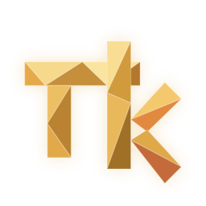

<p align="center"></p>

# pi-kit

A desktop app for the [pi](https://pi.dev) coding agent: work with AI in your
projects, review changes, and run tools without leaving the conversation.
Built with Electron, Angular and NestJS, with AG-UI and CopilotKit connecting
the interface to the agent.

## Download

Get the app from the **[latest GitHub release](https://github.com/Soverius-AI/pi-kit/releases/latest)**.
Choose the download for your platform:

| Platform | Download and install |
|---|---|
| macOS (Apple Silicon) | Open the `mac-arm64.dmg` and drag pi-kit to Applications. |
| Windows (x64 or ARM64) | Run the matching installer `.exe`, or use the `portable.exe` without installing. |
| Linux (x64 or ARM64) | Download the matching `.AppImage`, make it executable (`chmod +x <file>.AppImage`), and run it. |

Unsigned builds may trigger macOS Gatekeeper or Windows SmartScreen warnings.
Linux needs a graphical session and Electron runtime libraries; AppImages also
need FUSE 2. Signing, runtime requirements and troubleshooting details are in the
[developer guide](doc/development.md#install).

## Connect a model

The first-run setup helps you choose a provider or a local model.

- **Anthropic:** use a paid [Anthropic Console](https://console.anthropic.com/)
  API key with API billing enabled. A Claude subscription does **not** provide
  API access and cannot be used to sign in to pi-kit.
- **OpenAI:** use the current OpenAI login flow offered in setup or model settings,
  or configure an OpenAI API key. Legacy Codex login is not supported.
- **Local models:** use the guided local model setup or connect a compatible server.

Provider usage and billing are separate from the desktop app.

## Features

- Persistent project conversations, session history and background agents.
- Files, changes, terminal and code review alongside your chat.
- Git worktrees for parallel tasks, with merge-back and outcome tracking.
- MCP tools and apps, connectors, and generative UI in conversations.
- Skills, prompt templates and approved learning from completed work.
- Voice input, a desktop browser and screenshot attachments.
- Configurable credential storage and in-app updates.

## Develop

Use **Node.js 24** and **pnpm 11** (the exact pnpm version is pinned in `package.json`).
From the repository root:

```sh
corepack enable
pnpm install --frozen-lockfile
pnpm run dev          # Electron app with live development builds
```

Other useful commands:

```sh
pnpm run dev:web      # Browser development: localhost:4200
pnpm run check        # Checks, builds, lint and tests
pnpm run release      # Package for supported targets on this host
```

## Documentation

- [Developer guide](doc/development.md): packaging, signing, testing, configuration and operational details.
- [Architecture](doc/docs/architecture.md) and [repository structure](doc/docs/structure.md).
- [Backend](doc/docs/backend.md), [AG-UI events](doc/docs/agui-events.md) and [background agents](doc/docs/background-agents.md).
- [Architecture decisions](doc/docs/adr/), [design system](doc/docs/design-system.md) and [plugin contract](doc/docs/plugins.md).
- [HTTP API](doc/api/openapi.yaml) and [examples](examples/).

Run the documentation site with `cd doc && pnpm install && pnpm start`.

Built by Soverius.AI GmbH.
