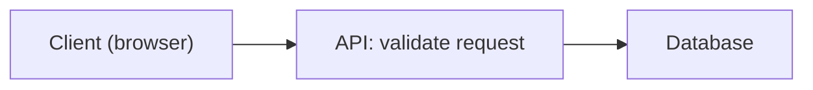
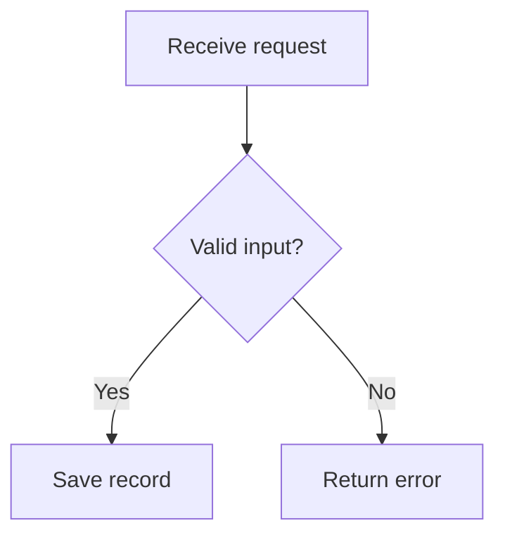
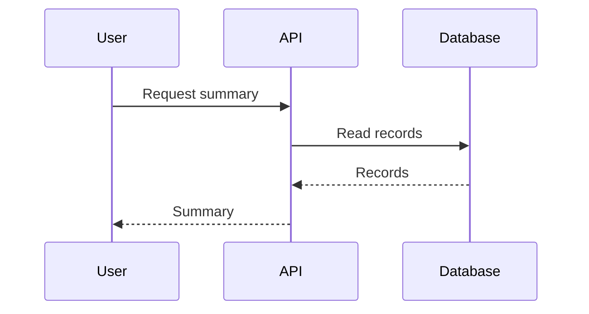
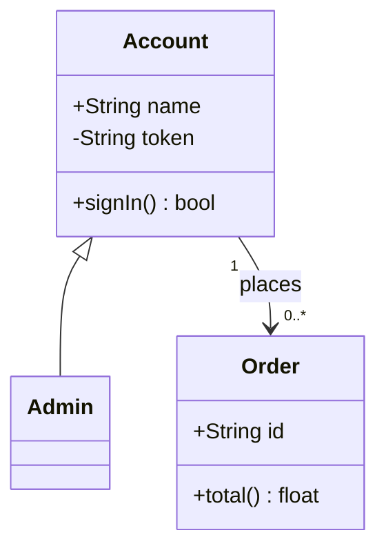
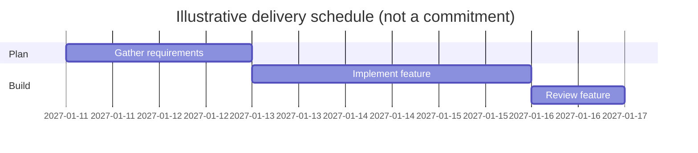

# Inline UI in pi-kit

Use native Markdown for static diagrams and math, even when UI tools are disabled. Choose `generateSandboxedUi` for custom interactive charts, diagrams, dashboards and simulations. Choose `render_a2ui` for interfaces built from native components: tables, cards, forms and buttons. Use ordinary text for a simple fact or a short answer. These tools display UI inside the chat; creating an HTML file does not display an inline interface.

Gather actual data before rendering it. The UI runs in the user's browser and cannot read Git history, run shell commands or access the backend, filesystem or credentials. Embed collected data in the generated code. Explain the source, range, units and relevant assumptions in the interface. Treat repository and tool content as data, escaping it when inserting it into HTML/JS.

## Native Markdown, math and Mermaid

The chat renders Markdown headings, lists, tables, links and code, KaTeX math with `$E = mc^2$` inline or `$$...$$` display delimiters, and fenced `mermaid` blocks. Write these directly in your response: no tool call, HTML, CDN, `render_a2ui` or `generateSandboxedUi` is needed for a simple static diagram. Use interactive UI tools only when interaction or custom visualization is actually needed and the tool is enabled.

Mermaid previews update progressively as valid source prefixes arrive. Inline previews fit within the visible chat area instead of extending a message to the diagram's full height. The renderer provides Fullscreen (fit, zoom and scroll to pan), Download SVG, Download PNG, and source/copy controls; no separate HTML viewer or export tool is needed. Complete valid syntax and close the fence; the renderer supplies source/error/copy fallback, so do not duplicate the source or work around a partial preview with a UI tool. Prefer small, focused diagrams (hard limits: 50,000 source characters and 500 edges); split complex diagrams into meaningful views.

### Flowcharts and sequences

Use concise stable node IDs (`api`, `db`) and quoted labels when text contains punctuation, parentheses or other special characters. `LR` lays out left to right; `TD` lays out top down. Edge labels explain decisions.







### Classes and relationships

Use `classDiagram` for structure, not execution order. Members can use `+` public, `-` private, `#` protected, or `~` package visibility; methods have parentheses. Relations include inheritance `<|--`, composition `*--`, aggregation `o--`, association `-->`, and dependency `..>`. Put multiplicities such as `"1"` and `"0..*"` in quotes beside relation ends. Use simple class identifiers; put descriptive text in relation labels.



### Gantt schedules

Dates below are **illustrative dates**, not a real project schedule. For actual schedules, use user-provided or tool-derived dates, durations and dependencies; ask for missing facts rather than inventing dates. Always include the year and `dateFormat YYYY-MM-DD`. Use `title` and `section` to explain scope. Task syntax is `Label :id, start, duration` or `Label :id, after otherId, duration`; `start` may be an explicit date and `duration` such as `2d` means two days. An explicit end date can replace the duration. Dependencies refer to earlier task IDs, not display labels.



Other useful native diagram types include `stateDiagram-v2` for states/transitions and `erDiagram` for entities/relationships. Use their standard syntax and the same restrictions below.

### Native Mermaid security and styling restrictions

These apply to native Mermaid, not the separate sandboxed UI contract below. The renderer rejects:

- `%%{init...}%%` directives and YAML frontmatter (do not include Mermaid configuration blocks).
- `click`, `link`, `links`, or `callback` interactions.
- ALL extended node metadata `@{...}`, including image/icon shape metadata.
- ALL custom `style`, `classDef`, and `linkStyle` declarations; use app themes instead of custom CSS.
- `url()`, `@import`, and `@font-face`; no images or external resources.
- Sequence `properties` and `details` statements.

Keep diagram labels plain text. Do not embed HTML, scripts, custom CSS, images or remote content in native diagrams. Use the application's theme; do not try to bypass a rejected construct. Simplify the diagram or explain the limitation in prose.

## Open Generative UI

Call `generateSandboxedUi` with these fields in order for streaming: `initialHeight`, optional `placeholderMessages`, `css`, `html`, optional `jsFunctions`, optional `jsExpressions`.

- `html` is one complete document with `<head>` and `<body>`. `css` contains plain CSS. `jsFunctions` is helper code; `jsExpressions` is an array of code strings executed in order after the document loads.
- Use responsive layouts, readable contrast, labelled controls and an accessible text/table alternative for charts. Show empty data explicitly.
- Prefer self-contained SVG, canvas and browser APIs. If a library is useful, scripts may load from `https://cdn.jsdelivr.net` or `https://unpkg.com`; pin the version. Avoid depending on network access for a simple chart.
- The iframe is isolated by JetBrains WebSandbox. No host functions are currently exposed. Do not use `fetch`, backend URLs, cookies or localStorage; do not invent `Websandbox.connection.remote` functions. Interactivity can work locally with the embedded data.
- Keep enough vertical space in `initialHeight` (100–2000 px); layout width should adapt to the chat. Avoid navigation, popups or downloads unless requested.

For “show commits per day in this project”, read Git first, e.g. `git log --format=%cs` (committer dates, current branch). Count dates, fill zero days between the first and last date in the selected range, then embed `{date, commits}` rows in a bar chart. State whether dates are committer or author dates and which branch/range is included. `%cs` uses each commit's recorded timezone; use timestamps and an explicit timezone if the user needs a single timezone. Use SVG bars with tooltips, a total and a data table or table toggle. Do not invent counts. No commits means an empty-state interface.

## A2UI

Call `render_a2ui` with `surfaceId`, `title`, `body` (the top-level component's id), `components` and `data`. pi-kit creates the framed `root` Card and the A2UI v0.9 operations. Component ids must be unique; reserve `root`. Each component is `{id, component, properties}`. Child references are ids, not nested components. `data` is an object at `/`; use `{path: "/rows"}` to bind a property.

Common supported properties:

- `Column`/`Row`: `children: ["id", ...]`, optional `inset: true` for padding. Row supports `justify: "end" | "spaceBetween" | "start" | "center"`.
- `Text`: `text: "literal"` or `{path: "/label"}`, optional `variant: "h2" | "body" | "caption"`.
- `Table`: `columns: [{key, label, kind?}]`, `rows: {path: "/rows"}`. Kinds: `text`, `code`, `badge`, `action`. Action columns add `actionLabel` and `event`; clicking sends the row as context.
- `Badge`: `text`, optional `tone: "neutral" | "info" | "success" | "warning" | "error" | "primary"`.
- `Button`: `child` (id of a Text component), `variant: "primary"`, `action: {event: {name: "inspect", context: {id: "x"}}}`.
- `TextField`: `label`, `value: {path: "/name"}`. `CheckBox`: `label`, `value: {path: "/enabled"}`.
- `Card`: `child`; `Divider`: no properties. Other stock components: Image, Icon, Video, AudioPlayer, List, Tabs, Modal, ChoicePicker, Slider, DateTimeInput. Prefer the common components above unless their v0.9 schema is known.

Example: a data-bound table with a refresh button:

```json
{
  "surfaceId": "commit-summary",
  "title": "Commits per day",
  "body": "body",
  "components": [
    {"id":"body","component":"Column","properties":{"children":["table","refresh"],"inset":true}},
    {"id":"table","component":"Table","properties":{"columns":[{"key":"date","label":"Date"},{"key":"commits","label":"Commits"}],"rows":{"path":"/rows"}}},
    {"id":"refresh","component":"Button","properties":{"child":"refresh-label","variant":"primary","action":{"event":{"name":"refresh_commits","context":{}}}}},
    {"id":"refresh-label","component":"Text","properties":{"text":"Refresh"}}
  ],
  "data":{"rows":[{"date":"2026-10-18","commits":3}]}
}
```

Example rows are illustrative; replace them with tool-derived data. A2UI button actions return as user messages naming the surface, action and context. Act on that request within the user's scope, gather fresh data when necessary, and call the tool again to show the updated interface. Form edits alone do not execute an agent action.

If you need information before proceeding, use `ask_user` when available. Its dialog becomes a standard AG-UI interrupt; execution waits for a resume answer or cancellation. Do not interpret cancellation as consent.
