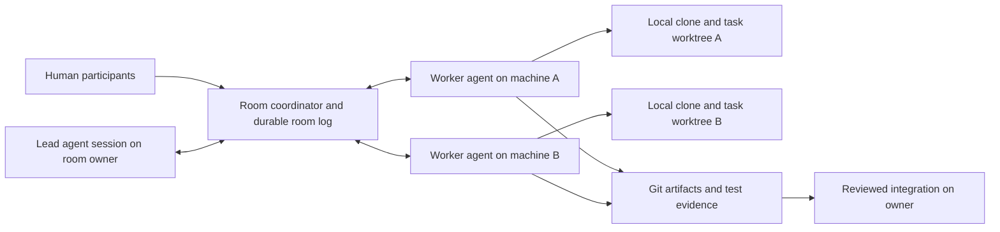

# Cross-machine chat participation and distributed coding workers

Status: Research and proposed direction; not an accepted ADR or implemented feature.

Repository baseline inspected: `b893a63`. External primary documentation is linked below; moving specifications must be version-pinned before implementation.

## Executive recommendation

Build **a shared collaboration room with one authoritative coordinator and multiple independently running local workers**.

A remote joins the conversation as an identified participant, discovers which repository and exact code snapshot the task concerns, maps or clones it locally with approval, runs an agent in a local task worktree, and returns messages and verifiable Git artifacts to the room. One integration owner reviews and combines the results.

In short: **share the conversation and work plan; distribute execution; integrate code through Git**.

Do not synchronize live pi JSONL files or SQLite databases between machines, make one session multi-writer, or treat a remotely opened thread as distributed execution.

This solves participation, not automatic availability: the room still needs a reachable home. Put that home on an always-on self-hosted instance if laptop sleep is unacceptable. Transparent room migration and offline multi-writer collaboration are separate, substantially harder projects.

## 1. What exists today

The current design is environment → project → thread, with execution on the project's owning environment. Opening another environment reloads the workbench against that owner; it neither copies the repository nor runs an agent locally.

| Existing foundation | Evidence | Consequence |
| --- | --- | --- |
| Stable instance identity and explicit reciprocal pairing | `apps/backend/src/peers/`, `libs/shared/protocol/src/peers.ts`, `doc/docs/remote-access.md` | Reuse identity and authenticated connectivity where suitable. |
| Private loopback backend, Tailscale Serve, reviewed remote routes | `libs/shared/service-host/src/remote-gateway*.ts`, `apps/backend/src/contract/remote.ts`, `libs/shared/protocol/src/remote-routes.generated.ts` | Keep backend tokens private and deliberately expose any new protocol. |
| Remote access is trusted owner control, not collaborator isolation | `doc/docs/adr/0035-remote-access-over-the-tailnet.md` | Existing peer approval is not a safe thread-scoped invitation for another person or untrusted worker. |
| pi session content is canonical; SQLite holds metadata and replay | `doc/docs/adr/0003-pi-sessions-are-the-source-of-truth.md`, `apps/backend/src/db/event-log.repository.ts` | Preserve a single writer for each pi session; do not turn replay caches into a replicated session database. |
| Durable run ownership and reconnect/replay | `apps/backend/src/db/event-log.repository.ts`, `doc/docs/architecture.md` | Reuse the streaming/replay approach, not assumptions that cursors survive log replacement or restart. |
| Durable background agents, reports, questions and isolated worktrees | `apps/backend/src/bg-agents/`, `doc/docs/background-agents.md` | Good worker lifecycle and UI foundations, but agents currently execute inside one backend. |
| Local soft file claims and agent awareness | `apps/backend/src/coordination/coordination.service.ts`, `leases.ts` | These are advisory, keyed by local folders, and capture read/edit/write tools rather than all shell effects. They are not distributed locks. |
| Worktree lifecycle and handoff | `apps/backend/src/worktree/worktree.service.ts` | Reuse locally on each worker; a worktree is not a cross-machine checkout transport. |

Specific constraints:

- A thread retaining its environment remains a valid invariant. Attaching a collaboration room must not silently retarget the thread's files, terminals, model calls or approvals.
- The current background-agent durable store has one backend owner, guarded by a SQLite owner lock and epoch. Remote workers need their **own** durable runtime; they must not open that same database over a network filesystem. Its owner epoch is not a distributed task-attempt or external-side-effect fence.
- Current isolated-agent worktree creation starts from the project through the local worktree service, not automatically the active thread worktree's exact HEAD/dirty state. The worker adapter must supply and verify the task's pinned base explicitly.
- Current report delivery into the main session is not a durable cross-machine acknowledgement. A persisted report or terminal agent status does not prove the lead received it; remote report acceptance needs a durable inbox and receipt.
- Current event-log cursor generations are process-local and change when history is cleared. A collaboration protocol needs a separately durable room cursor/generation and an explicit snapshot/reset contract.
- A peer proxy or existing background-agent endpoint still executes on the selected owner. It does not implement worker recruitment.

## 2. Patterns compared

| Pattern | Strength | Main cost or failure mode | Fit here |
| --- | --- | --- | --- |
| Remote UI into one backend | Simple; already implemented | Everything still runs on one machine | Keep for remote control, not the new feature. |
| Single-authority room plus distributed workers | Clear ordering, task ownership, attribution and integration; fits current ownership model | Coordinator availability is required | **Recommended first architecture.** |
| Broker/queue-backed worker fleet | Good scheduling and reconnect behavior at larger scale | Extra infrastructure; does not itself define chat, trust or repo semantics | Use the durable queue pattern internally; avoid requiring a broker initially. |
| Federated multi-writer room / CRDT | Offline concurrent messages and editable shared documents | Membership, revocation, causality, tool authority and side effects still need coordination | Defer. Consider CRDTs later for shared drafts or notes, not task execution authority. |
| Shared working tree or bidirectional filesystem/session sync | Appears convenient | Partial writes, divergent session trees, secret leakage and uncoordinated shell effects | Reject as the default. Git artifacts are the exchange boundary. |

A CRDT can merge text or data structures. It cannot decide whether a shell command should run twice, whether a worker still has authority, or whether two changes are semantically compatible.

## 3. Model: one room, many sessions

Separate four concepts that are currently easy to conflate:

1. **Room:** the durable shared timeline, members, decisions, tasks and artifact references.
2. **Participant:** a human or agent, authenticated through an environment; not just a display name.
3. **Agent session:** an execution context owned by one machine. Main and worker sessions have their own private context and canonical session storage.
4. **Checkout:** a local repository mapping and task worktree. Its absolute path is private/local, not portable identity.

The room coordinator is an application service, **not the lead LLM**. It enforces membership, ordering, task transitions and capabilities even if an agent makes a bad request. The lead agent proposes task assignments; deterministic code and policy authorize them.

### Storage and source of truth

Introduce a room ID distinct from the pi session ID. Attach a room to an existing thread through an explicit sharing action; do not redefine all local threads as shared sessions.

- Canonical room records: attributed public messages, membership changes, task transitions, decisions and artifact manifests.
- Canonical agent records: the existing local pi session or durable background-agent conversation, owned by that runtime.
- AG-UI: a presentation/replay projection of those records, not the worker dispatch protocol.
- Cross-links: room event ID ↔ local session entry/report ID, so retries do not inject the same report twice.

The new room log is a deliberate additional domain, not a second writable copy of pi's internal conversation tree. This needs a new ADR defining the boundary with ADR-0003. A solo thread can remain exactly as it is today.

### Chat routing

- Show author, human/agent kind and environment on every shared message and result.
- Default unaddressed human messages to the lead agent. `@worker` or explicit task messages target a worker; broadcast is explicit.
- A public message is not automatically a model turn on every machine. Otherwise cost, feedback loops and contradictory actions grow with every participant.
- Worker reports may wake the lead under policy; ordinary progress updates should not cause a new turn each time.
- Forwarded remote content is attributed data, never a system instruction or a claim to be the owner.
- Human collaborators and their agents are separate actors. A device key proves an environment, not which person is at its keyboard. Same-owner machines can be the first scope; multi-person collaboration requires distinct membership and attribution.

## 4. Proposed user journey

1. From a thread, choose **Share / Invite worker**. Show room owner, repository, what history will be disclosed and granted capabilities.
2. The remote accepts a short-lived room invitation and chooses **Join chat** or **Join and offer local execution**. Both owners approve worker execution separately from joining the room.
3. A preparation card says: “Repository X; base commit Y; task Z. Use an existing local checkout or clone into this folder?” Local paths and credentials stay local.
4. The worker verifies the base snapshot, local project trust, compatible tools and any missing submodules/LFS content. It reports ready, blocked or unsupported—never silently substitutes another branch.
5. The lead proposes a bounded task with acceptance criteria and output format. The scheduler grants one worker one task attempt; the worker explicitly accepts.
6. The worker runs in its own local worktree and publishes concise progress, questions and intended path/module claims. Detailed traces stay local unless shared on purpose.
7. The worker returns an immutable commit/patch artifact with base, head, changed paths and test evidence.
8. The integration owner fetches/imports into an isolated integration worktree, reviews the diff, resolves conflicts and reruns appropriate checks. The shared room records acceptance or requested revision.

Example: machine B joins a thread about `project-X`, maps it to an existing clone, offers Linux testing, and takes an “add regression test” task at a pinned commit. It does not inherit permission to use machine A's terminal or read all of A's projects.

## 5. “Which repo are you?” needs a portable contract

A folder path or branch name is insufficient. Use an approved repository descriptor:

| Field | Purpose |
| --- | --- |
| `repoId` | Room-approved logical identity, including explicit mappings for forks and renamed remotes. |
| Fetch locations | Credential-free, locally approved HTTPS/SSH locations; hints, not authorization. |
| Git object format and exact base commit | Reproducible starting point; verify that required objects exist. |
| Snapshot/tree identity | Required when the task depends on uncommitted owner changes. |
| Optional branch label | Human context only; branches move. |
| Submodule/LFS requirements | Detect missing external objects and require separate fetch authorization. |
| Environment hints | Runtime versions, lockfile identity and needed capabilities; not executable setup instructions. |

Repository identity cannot be inferred safely from URL normalization or a matching commit alone. The same history can exist in multiple forks, and URL aliases can differ. Require an explicit local mapping and validate expected history/snapshot.

Preparation rules:

- Match an existing local repo or obtain approval to clone; never overwrite a dirty local working tree.
- Use a dedicated task branch/worktree, conceptually `room/<roomId>/<taskId>/<attempt>`.
- Default v1 to tasks based on committed state. If the owner has dirty changes, ask to commit, exclude them, or explicitly export a reviewed snapshot; do not pretend workers see them.
- A Git bundle transfers committed objects, not arbitrary dirty/untracked files. Snapshot export needs a separate reviewed manifest and policy.
- Never copy credentials, `.env`, ignored files or the whole home directory as an implicit synchronization step. Respect that secrets can also be tracked in Git; preview disclosure scope and minimize exported objects.
- Offer read-only chat participation when checkout preparation fails. Joining the conversation and granting execution are independent actions.

## 6. Swarm coordination: tasks first, chatter second

Use a **durable task board / blackboard**. The shared room is for discussion; the task service is the source of truth for ownership and transitions.

A task needs: task ID, repository/snapshot, brief, acceptance criteria, dependencies, intended scope, assigned worker, attempt/epoch, capability limits, execution deadline/budget and output references. Record why an assignment changed.

Suggested lifecycle:

`proposed → offered → accepted → running → submitted → integrated`

With explicit `blocked`, `cancel-requested`, `cancelled`, `failed` and `superseded` outcomes. Network presence is separate: an unreachable worker is not proof that its task stopped.

### Delivery and ownership

- Persist outbound commands and inbound receipts (outbox/inbox). Retry delivery with stable command IDs scoped by room/environment; receiver deduplication must survive restarts.
- Commit accepted report/task transitions and their lead-inbox delivery intent atomically. Deliver into the lead session with deduplication and keep the intent until acknowledged; a network reply or completed worker status is not proof of model-context delivery.
- Accept task messages, transitions and results through coordinator transactions with expected state/version checks.
- Every assignment has an attempt number or fencing token. Reject authoritative updates from obsolete attempts; retain late artifacts as quarantined candidates for review.
- Use coordinator-authoritative deadlines rather than trusting wall-clock comparisons across machines.
- Fencing protects coordinator state and integration; it **cannot undo or prevent all local shell effects on a disconnected machine**.
- Do not promise exactly-once arbitrary tool execution. After a crash between an external effect and its receipt, the outcome can be unknown. Reconcile or ask before replaying destructive operations.
- Reassignment is safe only under an explicit policy: confirmed stop, expired bounded execution authority, or knowingly duplicated isolated work whose results are reviewed. Never equate a missed heartbeat with safe destructive-task retry.

### Coordination claims

Publish advisory module/path intent using repository-relative paths and the base snapshot. This makes overlap visible across clones without pretending their absolute paths are shared.

Keep current local soft claims for same-folder awareness. Do not upgrade them into a distributed exclusion guarantee: shell writes and external tools can bypass them, and independent changes can conflict even in different files.

Prefer tasks split by ownership boundary, with explicit dependencies for shared API/schema changes. One integration owner sequences landing. Agents may negotiate in chat, but the service records the actual accepted assignment.

### Budgets and approvals

Remote execution needs task-specific token/cost, duration and subprocess limits; current agents having no independent budget is not an appropriate distributed default. Secrets, network access, package installation and destructive actions remain governed by local worker policy. A room invitation cannot approve all future local commands.

## 7. Results are artifacts, not “I changed these files”

Prefer Git commits exposed through a locally approved remote/ref. Where no shared Git server exists, use a bounded Git bundle or patch artifact transfer; validate prerequisites and import only into an isolated repository/worktree.

An artifact manifest should include:

- task ID, attempt, worker identity and repository ID;
- base commit, result commit/tree, ordered commit range and changed paths;
- content digest, size and transport reference;
- test commands, result, tested tree identity and platform/toolchain context;
- limitations and any unresolved conflicts.

Security and correctness boundaries:

- A signed/digested artifact establishes origin/integrity, not that its code is safe or tests passed truthfully.
- Import does not run setup scripts, enable hooks or recursively fetch arbitrary submodules. Avoid arbitrary artifact URLs/SSRF; use authenticated, bounded transfer or approved Git locations.
- Fetch/import is separate from applying a change to the owner's working tree.
- Validate base compatibility and transfer required objects, not just their hashes; review on a disposable integration worktree. Run tests under local policy, then approve landing. Dirty owner state must never be overwritten.
- Serialize integration against an expected target HEAD and record artifact/attempt application idempotently, including recovery if the Git ref moves before its database receipt is written. Workers do not push directly to the target branch. Other local writers must also be considered; a thread's run lock is not a repository-wide merge lock.
- Test evidence is bound to the worker's tree. After combining two artifacts, checks must run again on the combined tree.
- Keep stale attempt results as proposals; do not auto-land them merely because they eventually arrived.

## 8. Security: worker trust is not owner trust

Existing reciprocal peer pairing grants owner-style access on reviewed routes. Reuse cryptographic identity/connectivity only where doing so preserves those semantics; do not require full reciprocal owner access just to join one room.

Introduce a separate collaboration grant, conceptually:

`room + member + environment + capabilities + expiry/revision`

Example capabilities: read shared history, send messages, offer execution, claim a named task, upload results, request integration. Integrating into the owner tree, executing owner-side tools and administering the machine are distinct higher privileges, denied by default.

Required boundaries:

- Short-lived, scoped room enrollment with explicit acceptance, key binding and revocation; invitations must not contain backend tokens.
- Enforce scope at the receiving service, not only at a gateway or in prompts. Existing broad owner routes must not become a backdoor for worker tokens.
- Local approval for checkout destination and execution. Matching repository identity never propagates another machine's project trust. Repository/setup content is untrusted, including instructions in checked-out files.
- Share only an approved task context/history window by default. Existing threads may contain keys, private paths, tool output or unrelated work; do not export all past messages automatically.
- Isolate worker tools with an OS/container sandbox if workers or repositories are not fully trusted. The existing `read-only` mode is explicitly not an OS security boundary, and a worktree is not a sandbox.
- Revocation and expiry must be enforced throughout stream and artifact-transfer lifetimes, not only when a connection opens. Recheck grant revisions/expiry, abort affected streams/transfers, and authorize queued commands again at delivery/acceptance so an old queue cannot restore revoked authority. This cannot retract downloaded code or instantly stop an unreachable process. Disclose that limitation and bound offline execution rights.
- Audit who requested an action, on which machine it ran, under which grant and task attempt, and who approved integration.

V1 can stay on the existing tailnet and need no hosted relay. Supporting arbitrary external collaborators would additionally need a deliberate connectivity and person-identity design; tailnet membership alone must never become room authorization.

## 9. Transport and protocol choices

Start with the project's typed HTTP contracts plus reconnectable SSE/NDJSON. A proposed outbound-worker topology lets workers initiate connections to the room owner to subscribe/claim and send progress/artifacts; only the coordinator needs inbound publication.

**This is not supported by current peer pairing unchanged.** `PeerIdentity` currently requires a canonical published `*.ts.net` HTTPS origin, pairing requires remote access enabled, and session establishment contacts the other instance's identity/challenge/session endpoints (`libs/shared/protocol/src/peers.ts`, `apps/backend/src/peers/peers.service.ts`, `peer-sessions.ts`). Reusing reciprocal pairing as-is requires both endpoints to be published. Outbound-only workers need a separate key-bound enrollment/authentication flow that does not require a published worker origin. Choose that explicitly rather than claiming new routes alone provide it.

Use a dedicated collaboration authorization scope and route surface. A new `@Remote()` annotation alone is not enough if its only caller model is still owner access. Browser collaborators also need origin/CSRF handling appropriate to their credentials.

A minimal durable event envelope could carry:

`protocolVersion, roomId, eventId, roomSequence, actorId, environmentId, kind, commandId, taskId?, attempt?, payload`

Derive actor identity from authentication, not caller-supplied labels. Give the room its own durable generation/sequence, acknowledgements, bounded history retention and snapshot+replay fallback. Presence/typing can be ephemeral. Apply message and artifact size limits and stream backpressure; progress can be coalesced without dropping authoritative task transitions.

### A2A, MCP, AG-UI and durable execution

- **A2A** is relevant at the remote agent boundary: discovery/capabilities, tasks, status, questions/messages, artifacts and streaming. Its specification explicitly separates messages from output artifacts. It does **not** define this product's repository identity, local approval, Git integration, shared room membership or hard execution isolation. Its send-message idempotency is optional, so an adapter must impose the stronger deduplication contract needed here.
- **MCP** remains useful for exposing approved tools/context to an agent. Even with task-related features, it is not by itself a shared-room or multi-machine checkout/merge design. Do not tunnel unrestricted shell tools as a substitute for bounded tasks.
- **AG-UI** remains the UI streaming/presentation layer. It does not need to become the scheduler or inter-machine authority protocol.
- **Temporal-style durable workflows** are a useful model for history, retries and asynchronous execution, not a reason to add Temporal immediately. First reuse existing durable execution and add the missing command journal/task ownership boundaries. Revisit infrastructure when scale or operational requirements justify it.

Recommendation: define the product invariants and narrow typed domain contract first; consider an A2A adapter when a non-pi-kit worker is an actual interoperability requirement. Do not invent a broad new agent standard or claim A2A compliance without a pinned version and conformance tests.

## 10. Disconnects, offline operation and migration

| Event | Proposed behavior |
| --- | --- |
| Worker disconnects | Show unreachable. Queue bounded local progress/results; finish only the authorized bounded work, or pause at the next safe checkpoint per policy. |
| Coordinator disconnects | No new authoritative assignments or integration approvals. Workers must not elect a new owner based only on timeout. |
| Lost task acknowledgement | Retry the same command ID; worker returns the persisted receipt, not a new run. |
| Worker crashes during a command | Recover into reconciliation/hold when effect is uncertain; do not blindly rerun. |
| Worker rejoins after reassignment | Old attempt cannot update canonical task state; its artifact can be reviewed separately. |
| History has been compacted | Fetch a permitted room snapshot, then replay from its cursor; do not replay side effects. |
| Membership is revoked | Block subsequent access/acceptance; downloaded history remains disclosed. |
| Room owner is asleep | Room is unavailable. Use an always-on self-hosted owner if continuous access is required. |

If the real requirement is “take this whole active thread to another machine and keep working when the old one is off,” add **explicit ownership transfer** later: quiesce assignments, reconcile uncertain side effects, create a verified checkpoint, transfer approved room/session artifacts, revoke or fence the old owner and activate a new owner epoch. Offline concurrent owners or automatic failover need a stronger replicated authority design. Merely copying a room log or changing a hostname is not safe handoff.

## 11. Incremental delivery and validation

### Stage A: shared participation, no remote execution

Deliver room membership, scoped invitations, attributed chat, approved context sharing, reconnect/replay and explicit message routing. Existing solo threads and peer remote control remain unchanged.

Exit checks: two instances see the same acknowledged room messages; duplicate sends appear once; revocation blocks access; no member can browse unrelated projects or call owner shell APIs; no message broadcasts accidental turns to every agent.

### Stage B: one remote worker end to end

Deliver repository mapping/approval, committed-base preparation, one bounded task, local isolated worktree, durable dispatch/receipt, questions, result artifact and reviewed integration. Reuse the agents panel where appropriate, but clearly label remote execution location.

Exit checks: a task pinned to commit X runs on the other machine and returns a reviewable commit. Test lost acknowledgements, restart, missing base, dirty local checkout, malicious fetch locations, refused trust and offline result upload. No credentials or unrelated history cross the boundary.

### Stage C: coordinated swarm

Deliver capability-based selection, dependencies, advisory module claims, multiple workers, bounded budgets, attempt fencing, disconnect reconciliation and a serialized integration queue.

Exit checks: conflicting artifacts require review; superseded results cannot auto-land; combined-tree tests run; unknown shell outcomes hold rather than replay; sleeping coordinator never produces two owners. Measure useful completion, duplicate work, task latency, integration conflicts and cost per integrated task—not just agents spawned.

Only then consider room transfer, external non-tailnet collaborators, third-party A2A workers and CRDT-backed shared drafts.

### Likely implementation seams, not a committed file plan

- New backend collaboration domain for rooms, members, durable messages, tasks, command receipts and artifact manifests.
- New protocol schemas and separate collaboration grants/authorization; retain reviewed gateway routes and existing owner semantics.
- Worker adapter around local durable execution in `apps/backend/src/bg-agents/`; no shared remote SQLite ownership.
- Portable repository mapping plus existing local worktree services; separate artifact import/integration service.
- Renderer additions in chat/agents/threads domains for attribution, membership, execution location, preparation and integration review.
- Follow the current domain boundaries; do not make renderer stores or the main agent responsible for distributed correctness.

## 12. Decisions to confirm before an implementation ADR

1. First audience: one owner's machines only, or different people and organizations? Recommend same-owner machines first, but keep room capabilities separate from owner grants from day one.
2. Is an always-on room owner acceptable? If not, ownership transfer/availability is a first-class requirement, not a later UI improvement.
3. Do participants join as humans, agents, or both? Recommend a model that represents both, with one lead routing default agent turns.
4. Is tailnet-only connectivity acceptable initially? Recommend reusing it rather than adding a relay/account platform during the worker feature.
5. Is an existing approved Git remote normally available? Recommend remote commit exchange first; bundle/patch transfer where needed.
6. How much prior conversation may a joining worker read? Recommend explicit task context and an approved history window, not implicit full-thread export.
7. Who may approve local execution, spend and final integration? Recommend local worker-owner consent and one designated integration owner.

## Primary external sources

These sources establish available mechanisms; the recommendation above is a synthesis specific to this repository, not a claim that any one standard solves the whole problem.

- A2A specification: https://a2a-protocol.org/latest/specification/ — tasks, messages versus artifacts, streaming, discovery, authentication and optional send-message idempotency.
- MCP architecture: https://modelcontextprotocol.io/specification/2025-11-25/architecture — client/host/server boundaries, tool/context integration and capability negotiation.
- Git worktree: https://git-scm.com/docs/git-worktree — multiple working trees attached to a local repository; shared repository metadata is not a network replication protocol.
- Git bundle: https://git-scm.com/docs/git-bundle — committed-object transfer, prerequisites and verification; it does not transfer dirty working-tree state.
- Yjs documentation: https://docs.yjs.dev/ — concurrent shared data types/CRDTs; useful for editable shared content, distinct from execution authority.
- Temporal workflow execution: https://docs.temporal.io/workflow-execution — durable execution/history/commands as a coordination pattern, not an immediate dependency recommendation.
