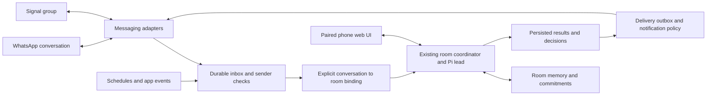

# Rooms as a personal assistant through phone conversations

Research date: 2026-11-23. Local application baseline: `c60a2aa`, based on main `29e7fa0` (0.93.0).

Status: original product and implementation proposal. The current [messaging implementation](rooms-messaging-channels.md) includes Telegram, WhatsApp, Signal and Slack, with BotFather onboarding for Telegram. At the research stage, no messaging account was connected, SDK installed, or live send performed. Implementation has since started on `feature/rooms-whatsapp`; see [the implementation status](rooms-whatsapp-implementation.md) for the pinned dependencies, available first slice and remaining live acceptance test. The owner checked their phone and **does not have WhatsApp Settings → Agents**. That rules out making the personal Agent Platform the first delivery path for this owner today.

This document updates the messaging recommendation in [the initial Rooms review](rooms-personal-assistant-review.md). The earlier WhatsApp discussion concentrated on Business Cloud API and linked-device bridges; a separate personal Agent Platform also exists and must be evaluated independently.

## Product recommendation

A room should be a persistent personal workspace that the owner can enter through a named conversation on their phone. The room owns the goal, conversation, memory, routines and outstanding decisions. WhatsApp, Signal and the existing mobile web application are ways into that room.

The room also needs a stable filesystem workspace with **linked folders**: existing notes, documents and repositories appear through named symlinks, while agents remain based in the room. See [Room workspaces and linked folders](rooms-linked-folders.md) for the working-directory, sandbox and cross-machine design.

For the owner's current account, prototype **one WhatsApp group per room through a QR-linked adapter**, with a separate assistant account as the baseline. Treat the unofficial transport as an experimental option. Evaluate **Signal group per room** as an alternative, with its own account-provisioning cost. Keep the paired mobile web application as the dependable entry for rich approvals, configuration and full history. Add the personal WhatsApp Agent Platform when it becomes available to the account.

The first experience should be concrete:

| Room | Conversation on the phone | What arrives there | Example reply |
| --- | --- | --- | --- |
| Personal | `pi · Personal` | Morning brief, due commitments, calendar conflicts | “Move that reminder to tomorrow.” |
| Research | `pi · Research` | Changes to a watched topic, with evidence | “Compare this with last week's conclusion.” |
| pi-kit | `pi · pi-kit` | Review requests, blockers and finished work | “Summarize the changes before I approve.” |

Each conversation is explicitly bound to its room. A reply never depends on whichever room happens to be open on the desktop. Archiving a room pauses its routines and delivery; it does not silently route its conversation to another room.

## What “channel” can mean on each platform

The desired product is a separate, replyable conversation for each room. Avoid promising that every messenger exposes a Slack-style channel object.

| Platform surface | Mapping to a room | Implication |
| --- | --- | --- |
| WhatsApp personal Agent Platform | One named agent chat per selected room | A clean future option when the account has access. Current access is limited, and the owner does not have it. |
| WhatsApp linked-device group | One explicitly selected group per room | Matches separate room conversations now, with an unofficial adapter. Use a dedicated assistant account for the first prototype. |
| WhatsApp Business direct message | Several rooms inside one business conversation require explicit routing | A room label or menu does not create separate native chats. This is a different UX from the requested room list. |
| WhatsApp Business Groups API | One API-created group per room, if eligible | Requires an Official Business Account; check adapter support separately. |
| Signal group | One group containing the owner and the assistant account per room | Natural room separation, but requires provisioning and maintaining the assistant account/client. |
| Paired mobile web | The existing Rooms UI | Full control and history, with the existing Tailscale/device-pairing requirements. |

WhatsApp Channels are oriented toward broadcasts. Current Channels also support audience questions and responses, so describing them as having no response mechanisms would be inaccurate. Their audience/admin model is still different from a private ongoing assistant conversation. Sources: [Meta's Channels overview](https://about.fb.com/news/2023/09/whatsapp-channels-heres-everything-you-need-to-know/), [current Channels questions](https://faq.whatsapp.com/1851671722412078/?cms_platform=web).

## SDK and onboarding findings

Package versions below were read from the public npm registry on the research date. They are evidence of published artifacts, not installed or validated dependency choices.

| Candidate | Verified capability | Fit for pi-kit |
| --- | --- | --- |
| Vercel Chat SDK | Common messaging event/adapter abstraction | Useful transport boundary while Pi continues to run each room's agent. It does not supply room identity or personal memory automatically. |
| `chat-adapter-baileys` 2.1.0 | Community WhatsApp Web adapter with an `onQR` callback and persistent auth hooks | First candidate for the owner's WhatsApp prototype. Its dependency range includes Baileys 7 release candidates, so pin and verify compatibility. |
| `@stibbons/chat-adapter-signal` 0.1.0 | Community Signal adapter backed by a separately run `signal-cli` | Candidate for the Signal prototype; early release, extra client lifecycle and provisioning. |
| `whatsapp-agent-sdk` 0.1.0 | Community TypeScript client for the official personal `/agent/v1` API | Relevant when Agents access arrives. This is not a Meta-maintained SDK. |
| `@chat-adapter/whatsapp` 4.45.0 | Vercel-maintained WhatsApp **Business Cloud** adapter | Do not confuse it with the personal Agent Platform or QR linking. |
| Novu Chat SDK adapter | Guided channel connection, identity and delivery infrastructure | Strong onboarding reference. Its WhatsApp setup still hands off to Business provider setup; it does not unlock personal Agents or make Business DMs into separate room chats. |

Primary references: [Chat SDK adapters](https://chat-sdk.dev/adapters), [Baileys adapter](https://chat-sdk.dev/adapters/community/baileys), [Signal adapter](https://chat-sdk.dev/adapters/community/signal), [personal TypeScript SDK](https://github.com/LRxDarkDevil/whatsapp-agent-platform/tree/main/whatsapp-agent-sdk), [Business adapter](https://chat-sdk.dev/adapters/official/whatsapp), [Novu adapter](https://chat-sdk.dev/adapters/vendor-official/novu).

The SDK the owner remembers could be Chat SDK, Novu's agent connection tooling, or a personal WhatsApp SDK. These are different layers; the research does not identify a single one with certainty.

### Available WhatsApp path: QR linking

Baileys operates through WhatsApp Web rather than Meta's official APIs. The adapter documentation explicitly warns about protocol changes and account suspension. This tradeoff should be visible when choosing the transport, rather than hidden behind a generic “Connect WhatsApp” button.

Proposed room setup:

1. Choose **Room → Phone conversations → WhatsApp → Linked device**. Use a dedicated assistant account; the owner’s personal account remains the authorized sender.
2. If using a dedicated assistant, first register that WhatsApp account through WhatsApp itself. SDK setup does not create a usable phone account from nothing.
3. Render the adapter's QR inside pi-kit and link it from that account's **Linked devices** screen. Save the resulting session through protected host storage and show connection/reconnect state.
4. Create a small group with the owner and assistant, or select an existing group that the owner controls. Confirm the room/group binding on the paired pi-kit UI and with a short challenge in that group. Initial implementation can use manually created groups rather than assuming group creation is exposed by the chosen adapter.
5. Deliver a test update there; require a reply from the authorized owner. Only then mark the binding ready.
6. Enable routines and notifications separately. Linking WhatsApp does not itself enable proactive messages or connect Gmail/Calendar.

The implementation requires the dedicated-account pattern. The earlier experimental personal-account bypass was removed at the owner’s request. Self-authored messages cannot link or operate a room.

For the group experience, process owner messages in bound assistant-only groups without an obligatory @mention. In a broader group, default to explicit mentions or quote-replies. Merely joining a group never grants access to a room, and adding another human does not grant the owner's tool permissions.

### Signal path: provision an assistant account, then bind groups

The community adapter runs against `signal-cli`, not an official Signal bot API. A dedicated bot account can be registered or linked from an existing bot phone. Linking the owner's personal account instead makes the client speak as that owner, while this adapter ignores own-device sync messages: it does not provide a ready-made self-chat assistant. Group messages map to one adapter thread; interactive cards fall back to text, so approve/snooze flows need text commands or web handoff. Sources: [Signal adapter setup and limitations](https://chat-sdk.dev/adapters/community/signal), [signal-cli provisioning](https://github.com/AsamK/signal-cli/wiki/Linking-other-devices-(Provisioning)).

Mirror the room-binding/test-reply steps above. Run and supervise the client on the host, keep it updated, and expose reconnect/relink instructions. QR linking an already provisioned assistant account is easier than registering a fresh account, but is not account creation. Signal's official [linked-device guide](https://support.signal.org/hc/en-us/articles/360007320551-Linked-Devices) explains the primary-device relationship and device limits.

### Future WhatsApp personal Agent Platform

WhatsApp's own [help page](https://faq.whatsapp.com/1050934623978152) confirms limited availability, up to five connected agents, creator-only chats and no access to other conversations. It also states that these agent conversations are not end-to-end encrypted. This matters when choosing which room information to send there.

The official [developer manual](https://www.whatsapp.com/developer/WhatsApp-Agent-Platform-Developer-Manual.pdf), version 1, describes creating an agent in WhatsApp, copying its chat API key, and receiving updates through outbound long polling. It has no documented group destination or automated agent-creation endpoint. Do not invent an OAuth or QR signup that bypasses the phone steps.

A future room wizard could guide those steps, store the key, verify a first owner message, and bind that agent identity to the room. One key needs one active polling owner across environments. Preserve the server cursor unchanged, durably enqueue received events before advancing it, and delay read/typing receipts until the event has been stored. The SDK documents that read receipts can remove messages from replay. Source: [personal SDK behavior](https://raw.githubusercontent.com/LRxDarkDevil/whatsapp-agent-platform/main/whatsapp-agent-sdk/README.md).

Keep a room independent of an agent slot: disconnecting a chat does not delete the room. More than five rooms should remain accessible through the web or another supported transport rather than implying unlimited native agent chats.

### Business API and managed onboarding

Business Cloud remains relevant for business-facing assistants, but it is a separate product choice. Its account/number onboarding, public webhook, reply-window and template requirements remain applicable to that integration. Novu's `connect` flow is useful for guided setup and delivery, but its WhatsApp path still requires Business provider configuration. Composio's existing [WhatsApp toolkit](https://docs.composio.dev/toolkits/whatsapp) also uses Business accounts.

Meta's [Business Groups API](https://developers.facebook.com/documentation/business-messaging/whatsapp/groups/) can create invite-only groups, so “official WhatsApp APIs never support groups” would be too broad. It requires an Official Business Account, caps groups at eight participants and excludes Business-app/coexistence numbers. The owner has not established that account eligibility, and compatibility with the candidate Chat SDK/Composio adapters remains unverified. It is an option to assess for a supported business deployment, not an automatic shortcut for personal onboarding.

## Integrate messaging around the existing room runtime

Keep the adapter concerned with transport. It should not start a second agent harness, decide which room owns a message, or maintain a competing canonical conversation.

Proposed records:

| Record | Purpose |
| --- | --- |
| Channel connection | Provider/adapter, owning environment, account identity, protected credential reference and connection health. |
| Room binding | Connection ID + native conversation ID + room ID + authorized owner identity, response policy and confirmation state. |
| Inbound event | Stable provider ID, sender, quote reference, room binding, received time and pending/processed state. |
| Delivery | Room event/run/action reference, destination binding, deduplication key, provider message ID and delivery/retry state. |
| Notification policy | Room timezone, quiet hours, urgency, digest frequency, suppression state and volume cap. |

Bind opaque provider IDs, not chat titles or display names. A renamed group remains the same binding. One native conversation should have one room binding by default. A later “concierge” DM may list or switch rooms, but it must use explicit state and quoted-message routing, never a model guess.

For overlapping input, `RoomLeadService.post` currently refuses owner messages while the lead is busy. A phone adapter needs a durable pending-message path and a clear “queued” response. Chat SDK's documented default is also `drop`; explicitly use queue/burst handling and retain the durable inbox as the source of truth. Do not conflate dropping an extra wake-up with dropping the user's words. Source: [Chat SDK overlapping messages](https://chat-sdk.dev/docs/concurrency).

The existing backend persists in SQLite. Chat SDK offers persistent state adapters for other databases; evaluate a bounded SQLite adapter or isolate its state service rather than adding an unexamined new infrastructure requirement. Verify the ESM dependencies against the Node 24 backend bundle before adoption.

## Ideas from Vercel Board

Vercel's [Board introduction](https://vercel.com/blog/introducing-vercel-board) describes persistent work threads, task claims and leases, event-triggered agents, scheduled follow-ups, internal-only updates, structured messages and scoped access. Its [documentation](https://vercel.com/docs/board) positions it as an experimental coordination layer with an ordered event log and tool synchronization.

Borrow these patterns for Rooms:

| Pattern | Proposed Rooms behavior |
| --- | --- |
| Work threads | Keep a request, evidence, decisions and result together within a room. |
| Event wake-ups | Resume affected work on an owner reply or source change. |
| Scheduled follow-ups | Store a next check; keep routine checks internal and send useful outcomes. |
| Claims and leases | Give a worker temporary ownership; recover abandoned work after checking external effects. |
| Structured updates | Track status, blockers and provenance independently of prose. |
| Scoped access | Authorize room operations separately from folder and connected-app access. |

These are design references, not a dependency decision. Board, Chat SDK and Composio serve different purposes: coordination, messaging transport and app access respectively. Validate any proposed combination before adoption.

### Apply the ideas to this owner's assistant

For pi-kit, keep the proposed one-conversation-per-room experience. Add a room-owned **work item ID** underneath it: an outbound message records both that ID and the provider's message ID. A quoted phone reply resolves through those stored references. An unquoted, ambiguous reply asks which item it concerns. This does not require WhatsApp or Signal to expose native subthreads.

For example, the owner sends “Prepare tomorrow's customer meeting using my notes.” The room creates a work item, reads its approved `folders/notes` alias, writes a brief into `outputs/`, and asks about one missing detail. The owner replies from the phone. The room updates the same brief and schedules one preparation check before the meeting. Completed work cancels obsolete checks; quiet hours still apply.

Persist a follow-up's work item, due time/timezone, reason, cancellation condition and attempt limit. An internal wake-up is not automatically a phone notification. Guard against a room's own mirrored messages repeatedly waking itself. Use stable event IDs for input deduplication and operation IDs for external writes; a lease alone cannot prevent a repeated calendar change after a crash.

The room overview should expose **Needs you**, **In progress**, **Waiting**, and **Done**, with the next check and output links on each item. Files remain in the stable room workspace; item records reference attachment IDs and relative output paths. Linking a folder does not broadcast its contents to the phone or connected tools.

## Gaps that most affect personal-assistant usefulness

These are application findings and proposed behavior, not features supplied automatically by a messaging SDK.

| Priority | Current gap / evidence | Required behavior |
| --- | --- | --- |
| P0 | `CreateRoomSchema` and `RoomsService.startIn` require Git/project context. | Create “Personal” or “Research” with a goal alone. Attach a repository only for coding work. |
| P0 | The room has its own folder, but lead/consultant execution still uses the project cwd. | A stable room workspace with named symlinks to attached folders and effective filesystem grants; see [linked folders](rooms-linked-folders.md). |
| P0 | No room/conversation binding or authorized human sender in the room event model. | Confirmed room routing and owner identity before accepting commands or delivering results. Keep v1 single-owner. |
| P0 | `RoomLeadService.inbox` is an in-memory map; busy `post` returns conflict. | Preserve messages/wake-ups across restarts and queue while work is running. |
| P0 | Polling records all new keys before taking only five items. | Process every item in durable batches; acknowledge only durably accepted work. |
| P0 | There is no human-channel delivery outbox in Rooms. | A proactive result is saved, delivered, acknowledged or shown as failed/retrying. Restart never silently drops a reminder. |
| P1 | Memory is room/playbook notes and `room_note` requires a playbook. | Owner-visible remember/show/edit/forget without a playbook, plus scoped recall. |
| P1 | No explicit personal commitment model. | A commitment has a status, due time/timezone, recurrence, source and next check; “done” and “snooze” update it deterministically. |
| P1 | Proactivity is primarily technical YAML schedules and polls. | A plain-language setup shows what runs, when, what can be changed automatically and when the owner will hear about it. |
| P1 | Messages carry text and images, not a general attachment envelope. | Preserve voice-note/document metadata and source messages; transcribe audio through the existing transcription service before prompting the lead. |
| P1 | Rich approvals and details live in the app. | Short phone summaries, explicit decision IDs and stable room/action links into the paired web UI. |
| P1 | A desktop may sleep; connector authentication may expire. | An always-on host option, last successful check, stale-source indicators, reconnect and re-auth flows. |

Memory needs four distinct concepts: personal preferences, room-specific facts, reusable lessons/routines, and a structured ledger of commitments. Do not use one unbounded notebook as all four. Facts should retain source and update time; corrections replace or supersede the right item. Cross-room access should be deliberate: sharing working hours is useful, copying a private room's content into a project group is not the default.

Useful proactive behavior should close a loop: observe a source, compare with what is known, decide whether something matters, act within the chosen permission, notify once, and incorporate the owner's reply. A morning brief without remembered decisions, snooze/completion handling and change suppression becomes another feed to manage.

Approvals must resolve to a specific pending action in that room and destination. A bare “yes” is sufficient only when exactly one unexpired prompt is unambiguous. Otherwise ask which action. Verify the owner on each inbound approval and show a preview of the exact effect; group membership alone never grants the owner's Composio account.

## Proposed onboarding inside Rooms

The room should show three short setup steps: **Choose where to talk → Connect the tools it needs → Set when it may act**. Advanced provider details belong in the relevant setup step, not in the day-to-day conversation.

1. Create the room from its purpose, with an optional starter routine: morning briefing, commitments, research watch or project watch. Optionally attach existing folders under room aliases; the agent remains based in the room workspace.
2. Choose mobile web, WhatsApp linked device, or Signal. Keep personal WhatsApp Agent Platform unavailable for this account until its feature appears. Show the concrete account/QR requirement for the selected option.
3. Connect or reuse a host-owned channel connection, select a conversation, and verify a test reply. Display the room name, conversation and host together before saving.
4. Connect the necessary source apps through existing Composio/MCP flows. Channel linking and tool-account sign-in are separate operations.
5. Preview the routine: example brief, schedule in the owner's timezone, quiet hours, delivery destination and permitted actions. Begin with read/draft behavior.
6. Offer “Test now” and record a run plus a visible delivery result. Mark setup complete after a real round trip, not after an API key was accepted.

Day-to-day controls should include “what are you watching?”, “what do you remember?”, “pause this room”, “snooze”, “done”, and “open the full result.” Translate these into room operations shared by all entry points.

## Next implementation slices and acceptance

1. **Transport and identity spike:** one assistant account, two bound groups/rooms, bidirectional text and a test proactive update. Verify cross-room isolation, reconnect/restart, self-message filtering and sender identity. No production promise until that round trip works on the owner's phone.
2. **Durable room loop:** introduce inbox/outbox records, fix polling batches and busy input, and show queued/delivered/failed states. Associate inputs, runs, follow-ups and deliveries with stable work item IDs, preserving quoted-reply routing. A duplicate provider event produces one room message and one action, not two. A restart recovers an outstanding check; completion cancels it, and an internal check creates no phone message unless the notification policy calls for one.
3. **Assistant room foundation:** allow rooms without Git, add a stable workspace with [linked folders](rooms-linked-folders.md), memory controls and commitments, then ship a morning brief with quiet hours and snooze/completion. Restart and time-zone changes preserve the intended reminder behavior.
4. **Phone ergonomics:** add voice notes, documents, room/action deep links and short approvals. Check that new group members cannot act as the owner and that revoking a binding stops delivery without deleting room history.
5. **Additional transport:** implement Signal or the personal WhatsApp API behind the same binding/inbox/outbox contract. Existing room routines and memory should not need migration merely because the owner changes messenger.

The first product milestone is **two named phone conversations, two rooms, one remembered commitment and one scheduled update that can be replied to**. That demonstrates the desired assistant experience more directly than adding more playbook configuration screens.
