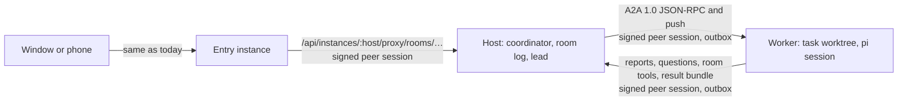

# Rooms: transport between entry, host and workers

Status: proposal for the rooms MVP ([handoff](rooms-and-threads-ux-handoff.md), [ADR-0038](../docs/adr/0038-rooms-for-cross-machine-work.md)). Date: 2026-11-19.

This answers open decision 2 of the handoff: how the window reaches a room whose host is another machine, how the host reaches its workers, and what happens when any of them is offline. It reuses remote access and peer pairing ([remote-access.md](../docs/remote-access.md), [ADR-0035](../docs/adr/0035-remote-access-over-the-tailnet.md)) and adds no new network path.

## 1. Three roles

| Role | What it is | Example |
| --- | --- | --- |
| **Entry** | The instance a window or phone is connected to. It serves the room list and forwards room calls. | This Mac's desktop app; Server for a phone paired with Server |
| **Host** | The instance that owns a room: the coordinator, the room log, the task board, the lead session and the integration worktree. The only authority for that room. | Server |
| **Worker** | An instance that runs tasks for a room in its own worktrees, with its own pi sessions. | Desktop, Laptop |

One instance can hold several roles: the entry can be the host, and the host can also run tasks.

**Reachability rule (v1):** the host must be directly paired with the entry and with every worker. That is the existing one-hop rule; there is no relaying through a peer of a peer. Start a room lists only environments that are directly paired with the chosen host.



## 2. Window → host: always addressed to the host

The renderer already reaches another instance through the entry with `scopedBackendConnection(entry, instanceId)`, which prefixes `/api/instances/:instanceId/proxy`. The entry's `PeerProxy` forwards to the peer's `/api/peer/api/…` over a signed session, the peer checks the reviewed-route allowlist again, and a call addressed to the entry itself goes through `PeerProxy.self`.

Rooms use exactly that, with one difference from the workbench:

- The workbench's connection is fixed to one execution owner per document (`configureWorkbench`), and switching environments reloads the document.
- The rooms store (`libs/rooms/data`) never uses the workbench connection. It builds a connection per host from `ENTRY_CONNECTION`: `scopedBackendConnection(entry, room.hostInstanceId)`.

So switching the workbench to another environment's project changes nothing for rooms: every room call still goes entry → host. This is how the rooms list "stays put" across environment switches without a second proxy.

All room routes live on the host under `/api/rooms/…`, are marked `@Remote()`, and are reached the same way whether the host is the entry or a peer.

## 3. The room list: a directory on every entry

Hosts are authoritative for their rooms, but the list must still show a room whose host is asleep ("Host offline", never silently gone). Each instance keeps a small **room directory** cache:

`room_directory(room_id, host_instance_id, title, repository, agent_count, attention, unread, last_seen_at, host_reachable)`

- **Filled** when the owner creates a room from this entry, and by a refresh that asks each directly paired peer with Rooms (preview) on for `GET /api/rooms` (rooms it hosts). The entry's own hosted rooms come from its database directly.
- **Kept** when a host is unreachable: the row stays, `host_reachable = false`, and the sidebar shows **Host offline**. A row disappears only when its host answers that the room is archived or unknown, or when the pair is removed.
- **Refreshed** on startup, when a peer comes back online, and from the host summary streams below. No polling loop beyond what peer presence already does.
- Served to the renderer by the entry's own `GET /api/rooms/directory`, a local call that never waits on a peer.

A phone gets the list of the instance it is paired with. Rooms hosted on a machine that is not directly paired with that instance are not listed; that follows the one-hop rule and is said in Start a room.

## 4. Live updates: one summary stream per host, one detail stream per open room

Both are SSE through the existing proxy, which already forwards `last-event-id` and streams responses.

| Stream | Route on the host | Carries | Opened |
| --- | --- | --- | --- |
| Summary | `GET /api/rooms/events` | Per room: title, unread count, attention (waiting, paused, result to review), agent presence | Once per reachable host that has rooms in the directory, while the app runs |
| Detail | `GET /api/rooms/:roomId/events` | The room log: messages, agent-to-agent rows, task transitions, join cards, guard stops, results | While that room is open |

The detail stream uses the room's own durable sequence, not the thread event log's process-local cursors (research §1). The envelope:

```ts
{ protocolVersion: 1, roomId, eventId, roomSequence, actorId, environmentId, kind, commandId?, taskId?, attempt?, payload }
```

- `actorId` and `environmentId` come from the authenticated caller on the host, never from the payload.
- Reconnect sends `Last-Event-ID: <roomSequence>`; the host replays from there. If that sequence is no longer retained, it sends a `snapshot` event first, then continues.
- Progress can be coalesced; task transitions, questions, results and guard stops are never dropped.

The entry merges summary streams into its directory and into **Needs you**, so a question from a worker on Desktop reaches the phone through the entry without the phone knowing Desktop exists.

## 5. Host ↔ worker: commands both ways with an outbox

Host and worker already hold a reciprocal pair, so each can open a signed session to the other. Neither side calls the other's general owner routes for room work; each uses a narrow route surface:

| Direction | Route | Purpose |
| --- | --- | --- |
| Host → worker | `POST /api/room-worker/enroll` | Join a room: room id, host, role, repository, base, roster. The worker checks Rooms (preview), the repository mapping and the base commit, and answers with what it has ready. |
| Host → worker | `POST /api/room-worker/tasks` | Start an approved task: task id, attempt, base, brief, acceptance criteria, budget. |
| Host → worker | `POST /api/room-worker/tasks/:taskId/messages` | Deliver an answer or a lead message to the worker's session (`triggerTurn` per the guardrails). |
| Host → worker | `POST /api/room-worker/tasks/:taskId/stop`, `GET …/status` | Stop and reconcile. |
| Worker → host | `POST /api/rooms/:roomId/reports` | Progress, questions, `room_post`, `room_send`, `room_ask_human`, task transitions. |
| Worker → host | `PUT /api/rooms/:roomId/tasks/:taskId/result` | The result bundle (§6). |

Delivery rules (research §6):

- Every command carries a stable `commandId`, and task commands carry `attempt`. Each side persists outbound commands in an **outbox** and retries with backoff while the peer is unreachable. The receiver keeps an **inbox** of applied `commandId`s that survives restarts and answers a duplicate with the stored receipt.
- The host rejects authoritative updates from an obsolete attempt; a late result from one is kept as a quarantined candidate.
- The worker accepts host commands only for rooms it has enrolled in and only from that room's host. This is checked in the worker's service, not only by the gateway.
- **Guardrails are applied on the host.** A worker's `room_send` is a report; the coordinator decides whether it wakes the lead, counts the hop and charges the budget. Workers never message each other directly.
- No wall-clock comparison across machines: deadlines are host-side.

## 6. Results travel as Git bundles

The worker is not a Git server, and pushing task branches to the repository's remote would need credentials and leave branches behind. So:

1. The worker commits in its task worktree and creates `git bundle create <file> <base>..<head>`.
2. It uploads the bundle with its SHA-256, size, base, head, changed paths and test evidence to `PUT …/result`, streamed, with a size limit (proposal: 50 MB; larger results fail with a clear reason).
3. The host verifies the digest and that the bundle's prerequisite is the task's base, stores it by digest, and shows the result card.
4. **Review** fetches the bundle into a read-only ref on the host; **Integrate** merges it in the host's integration worktree against the expected target head and records the outcome idempotently (research §7).

This settles handoff open decision 3: integration happens on the host's integration worktree, from a bundle.

## 7. Rooms (preview) and route exposure

The remote allowlist is generated from the API contract at build time, so it cannot follow a runtime setting. Instead:

- Room and room-worker routes are `@Remote()` and in the contract.
- A `RoomsEnabledGuard` on both controllers reads `collaboration.rooms` from the instance's settings and answers **404** when it is off, so an instance with it off looks as if rooms do not exist.
- Start a room and Add environment ask each candidate for `GET /api/room-worker/readiness`. A 404 shows "Rooms off on Desktop"; an older pi-kit shows "Update pi-kit on Desktop".
- Turning the setting off on a host stops its summary and detail streams and its outbox; nothing is deleted. Turning it off on a worker makes it refuse new tasks; running tasks are stopped like any stop.

This replaces the handoff's "not added to the gateway allowlist" with an equivalent runtime check.

## 8. Authorization in v1

v1 rooms belong to one owner, and every machine involved is already paired with owner-level access on reviewed routes. Rooms reuse those signed peer sessions and do **not** add a separate collaboration grant yet (research §8). To keep the later grant model possible:

- room-worker routes check room enrollment and the caller's instance on every call;
- the host checks that a report's caller is the enrolled worker for that task and attempt;
- every room record stores the authenticated environment, never a label from the payload.

Several people, or workers that are not the owner's machines, need the separate grant and person identity from research §8 before rooms can include them.

## 9. Failure behavior

| Situation | What happens | What the owner sees |
| --- | --- | --- |
| Host offline | The directory keeps the room; summary and detail streams retry with peer presence | Room row "Host offline"; opening it shows the last snapshot read-only and "Host offline. Nothing runs elsewhere." |
| Entry offline (phone cannot reach it) | Nothing changes on the host; work continues | The phone shows its usual "offline" state |
| Worker offline | Host outbox queues commands; worker outbox queues reports | Task card "Last seen 3m ago. The task may still be running."; messages to it "Queued for Worker · Desktop" |
| Lost acknowledgement | Same `commandId` retried; receiver returns the stored receipt | Nothing |
| Worker restarts mid-task | Worker reconciles from its persisted task record; if a side effect is uncertain it reports `blocked` and asks | A question in Needs you |
| Pair removed | Host stops the worker's tasks it can reach and marks the rest unreachable; the worker drops its enrollment | Join card "Desktop left: pair removed" |
| Setting turned off on host | Streams close; room is hidden at every entry | Rooms disappear from the list; "Rooms are off on Server" if one is opened from a link |

## 10. Code areas

- **Protocol:** `libs/shared/protocol/src/rooms.ts` with the envelope, directory row, commands and reports as zod schemas, generating OpenAPI and the client ([ADR-0027](../docs/adr/0027-api-contract-zod-swagger-typed-client.md)).
- **Backend:** `apps/backend/src/rooms/` in the four-role layout ([ADR-0034](../docs/adr/0034-backend-domain-folders-four-roles.md)): `rooms.controller` (host routes), `room-worker.controller` (worker routes), `room-directory.service`, `room-coordinator.service` (log, tasks, guardrails), `room-outbox.service`, `room-bundles.service`, and repositories with migrations for rooms, room events, tasks, directory, outbox and inbox.
- **Peers:** `PeerSessions`/`PeerHttp` reused for host ↔ worker calls; no change to pairing.
- **Renderer:** `libs/rooms/data` builds per-host connections from `ENTRY_CONNECTION` with `scopedBackendConnection`, never from the workbench connection.

## 11. Tasks across machines over A2A

A task is machine-agnostic: it records `environmentId` (which pi-kit instance runs it), `attempt`, `base`, `branch`, `head`, `files` and the worker's `report`. Approve offers **Run on** this computer or any paired environment whose A2A agent card (`GET /api/a2a/.well-known/agent-card.json`) offers JSON-RPC at A2A 1.x and the room-task extension. A remote worker changes only how the host starts and hears from the worker; the task card, the approval and integration stay the same:

| Step | On the host | On a paired worker (built) |
| --- | --- | --- |
| Approve | Host creates a worker thread in a worktree at `base` | Host sends A2A `SendMessage` to `POST /api/a2a` over the peer session; the worker creates the worktree and thread on its own machine |
| Run | `runHeadless` on the host | `runHeadless` on the worker; progress and questions come back as A2A push notifications to `POST /api/rooms/a2a/push` |
| Result | Commit in the worktree, numstat, report | The same on the worker; the completed A2A `Task` carries the report and the Git bundle (§6) as artifacts |
| Integrate | Merge the task branch into the project's checked-out branch | Fetch the bundle on the host, then the same merge |

**As built:**

- `PeerProxy.call(peerId, path, method, body)` is the backend's JSON call to a paired instance over the signed peer session (renewed once when the peer asks).
- On the receiving instance `PeerProxy.local` adds `x-pi-peer-id` with the authenticated caller; remote hops already strip every `x-pi-peer-*` header, so phones and devices cannot forge it. The worker's A2A calls on a task accept only the room host that sent it; a push is accepted only from the environment running that task and attempt, and only with that attempt's notification token.
- The worker finds its clone by matching the normalized origin of its known projects and checking that the base commit exists; it never fetches. Linked worktrees (pi-kit's own included) never count as clones. With several, the worker takes one without uncommitted changes first, then the most recently opened: it only adds a branch and a worktree there, but leaves an active, dirty checkout alone when it can.
- A room integrates into one folder, shown in the room's header (`RoomDetail.projectFolder`). Started from a thread, that is the thread's folder. Started from a repository and base commit, it is the only clone there; with several, `POST /api/rooms` needs `projectFolder`, the start dialog asks which (from `GET /api/rooms/clones`, also through the peer session for another host), and without one the host refuses and lists them. Without one the host gets "No project on this computer is a clone of … with commit …" and the task stays proposed.
- Worker threads are hidden on the worker too (`room_worker_tasks`).
- Push notifications go through a durable outbox (`room_outbox`) on the worker: kept until the host answers, delivered in order per host, retried after 5 s, 15 s, 30 s, 60 s, 120 s and then every 5 minutes, and dropped after a day. A push the host refuses (403, 404, 409) is dropped. When a worker's pi-kit starts, tasks it was still running are reported as failed ("restarted while the task ran").
- **Worker questions.** When a worker's pi stops at a dialog (an approval, a choice, a text), the run is no longer cancelled. The worker pushes a status update in `TASK_STATE_INPUT_REQUIRED` with the questions; the host stores them on the task (`questions_json`), counts the task as waiting and posts "The worker on … needs you". The owner answers on the task card (`POST /api/rooms/:roomId/tasks/:taskId/answer`); the host sends them to the worker as a `SendMessage` on the same A2A task, which resumes the run with them (`AguiService.resumeHeadless`). Stop cancels a pending question. Questions wait in memory on the worker: a restart while waiting ends the task as failed.
- **Lead questions.** The lead's dialogs work the same way on the host. They are stored on the room (`rooms.lead_questions_json`), count as one waiting item and show in place of the lead's "Thinking…" line. The owner answers with `POST /api/rooms/:roomId/lead/answer`, and the lead's turn resumes. Skip declines the question, and pi carries on without it. While the lead waits, prompting it again is refused. A restart clears the stored questions.
- Bundles are capped at 20 MB, because the peer gateway allows 30 s per request; larger results fail with that reason. Streaming large results is open.
- **Many hosts.** `GET /api/rooms/directory` returns this instance's rooms plus every active peer's `GET /api/rooms`, asked in parallel with a 5 s limit. Answers are cached in `room_directory`; a peer that does not answer keeps its last rooms marked unreachable (the sidebar shows "Host offline"), a peer with rooms off lists none, and unpaired peers are forgotten. The renderer refreshes the directory every 30 s while rooms are on.
- Each room carries `waiting`: its proposed and submitted tasks. The sidebar counts it on the row, puts waiting rooms first and marks the Rooms switch while the thread list is shown.
- **Start a room on another host.** `GET /api/rooms/hosts` lists this instance and every active peer with whether rooms are on there. For a remote host the renderer sends `POST /api/rooms` to that host with the repository and base commit instead of the local thread; the host finds its own clone the same way a worker does and stores it as the room's `project_folder`. Every later call for that room goes to its host through the owner client, as before.

**A2A 1.0 between pi-kit instances.** Hosts and workers talk [A2A](https://a2a-protocol.org/v1.0.0/specification) 1.0 over the JSON-RPC binding, carried by the signed peer session. Both sides use the official JavaScript SDK, [`@a2a-js/sdk`](https://github.com/a2aproject/a2a-js) (pinned at 1.3.0): its `DefaultRequestHandler` and `JsonRpcTransportHandler` serve `POST /api/a2a`, and its `ClientFactory` with the JSON-RPC transport calls it. pi-kit supplies what the SDK leaves to the agent:

| SDK seam | pi-kit class | What it does |
| --- | --- | --- |
| `AgentExecutor` | `RoomWorkerService` | Runs a room task in the order A2A streams require: a `task` event in `TASK_STATE_WORKING`, status updates while it runs, `TASK_STATE_INPUT_REQUIRED` for a question, then an artifact update for the report and one for the bundle, and a terminal status update. Each `SendMessage` drives the run to its next stop, so an answer resumes the same execution. |
| `TaskStore` | `RoomA2aTaskStore` | Keeps A2A tasks in SQLite (`a2a_tasks`), scoped by the calling instance, so `GetTask` and `ListTasks` survive a restart. |
| `PushNotificationStore` | `RoomA2aPushStore` | Keeps push settings in SQLite (`a2a_push_configs`), scoped by the calling instance, so the ones given with `SendMessage` and the ones added later with `CreateTaskPushNotificationConfig` survive a restart and can be listed, read and deleted. It refuses any target but the caller itself (`pi-kit-peer://<caller>/api/…`) with `-32602`. |
| `PushNotificationSender` | `RoomA2aPushSender` | Puts each `StreamResponse` in the durable outbox (`RoomOutbox`) once for every saved push setting of the task, in order, with that setting's token. Artifact updates are not pushed on their own: the terminal status goes out as the whole `Task`, with its artifacts. |
| client `fetchImpl`, `AgentCardResolver` | `RoomA2aClient` | Turns the SDK's HTTP calls to `pi-kit-peer://<instance>/…` into peer-session calls. Pi-kits find each other only through the agent card: the readiness check in Run on and the SDK client read the same card with the same resolver, and the client calls the interface the card names. |
| `User` | `PeerUser` | The authenticated caller is the paired instance (`x-pi-peer-id`); the SDK scopes tasks by it. |

- **Agent card.** `GET /api/a2a/.well-known/agent-card.json`, the card paired pi-kits read through the peer session: one `JSONRPC` interface at `pi-kit-peer://<instance>/api/a2a` with `protocolVersion` 1.0, push notifications and streaming on, the skill `room-task`, and the required extension `https://pi-kit.dev/a2a/extensions/room-task/v1`. Callers declare it in `A2A-Extensions`; the SDK refuses calls that do not. A peer whose card lacks the interface or the extension shows "speaks no compatible A2A version". A call without `A2A-Version` counts as 0.3 and gets `VersionNotSupportedError` (-32009). Both service parameters may also come as query parameters (`?A2A-Version=1.0&A2A-Extensions=…`).
- **Well-known card.** `GET /.well-known/agent-card.json` (outside the `/api` prefix, where A2A clients look) serves the same agent with two interfaces: this server's `<origin>/api/a2a` first, then the `pi-kit-peer` one. It declares the pi-kit token as an HTTP bearer security scheme and requirement, and like every route it needs that token itself. A client with the token reaches the agent, but a room task still has to come from a paired pi-kit: without a peer caller the worker rejects it.
- **Streaming.** `SendStreamingMessage` and `SubscribeToTask` answer with Server-Sent Events (`text/event-stream`): one JSON-RPC response per `data:` event, a `: ping` comment every 20 s, and the end of the stream when the task ends or stops for input. A client that closes the connection ends its subscription, not the task. Hosts still follow their own tasks by push, because a push survives the host being offline.
- **Start.** Approve sends `SendMessage` with `returnImmediately` and a `taskPushNotificationConfig`. The text part holds the title, brief, acceptance and base for any reader; `metadata[<extension>]` holds the room offer (room, task id, attempt, repository, base). The worker answers with a `Task` in `TASK_STATE_WORKING`, whose id the host stores (`room_tasks.a2a_task_id`); the `contextId` is the room id. A refused offer (no clone, a caller that is not the host, an attempt that already runs) comes back as a `Task` in `TASK_STATE_REJECTED` with the reason as its status message.
- **Push.** The push URL is `pi-kit-peer://<host instance>/api/rooms/a2a/push`. The worker refuses a URL that names another instance than the caller. Each attempt gets a random token, sent as `X-A2A-Notification-Token` and compared by the host; pushes for a task that already ended are ignored.
- **States.** Branch, head, changed files and questions ride in the extension's metadata; the note is the status message. The final `Task` carries the `report` artifact (Markdown) and the `changes` artifact (the bundle as a `raw` part, `application/x-git-bundle`).
- **Answers and stop.** An answer is `SendMessage` on the A2A task with the answers in the extension's metadata; a plain text answer from another client answers the first open question. Stop is `CancelTask`.

The task model maps onto A2A like this:

| Room | A2A |
| --- | --- |
| Task (`id`, attempt, title, brief, acceptance) | a `Task` per attempt; the first `Message` carries the brief and the offer |
| `proposed`, `declined` | not sent (the owner approves before A2A sees the task) |
| `running` | `TASK_STATE_WORKING` |
| a worker question | `TASK_STATE_INPUT_REQUIRED` |
| `submitted` | artifact updates `report` and `changes`, then `TASK_STATE_COMPLETED` |
| `failed` | `TASK_STATE_FAILED` (and `TASK_STATE_REJECTED` when refused) |
| `stopped` | `TASK_STATE_CANCELED` |

**Outside A2A agents as workers.** Settings › Advanced › A2A agents keeps agents that are not paired pi-kits (`a2a_agents`, routes `GET/POST /api/rooms/agents`, `DELETE /api/rooms/agents/:agentId`, local only). Adding one reads its agent card at the given address (its base address or its `agent-card.json`) and keeps the card's name. A bearer token goes to the credential store, or to the database where there is none (the row says which). `RoomA2aAgents` holds one SDK client per agent over plain HTTP(S), JSON-RPC or HTTP+JSON as the card offers, with the token on every call, and declares the room-task extension only to agents whose card names it.

- **Run on** lists each agent with whether its card answers; agents never show as room hosts.
- **Start.** The same `SendMessage` as for a pi-kit, without a push config: an outside agent cannot reach this machine. An agent that answers with a `Message` instead of a `Task` ends the task at once with that text as its report; one that answers `TASK_STATE_REJECTED` leaves it proposed.
- **Following.** When the agent's card says it streams, the host subscribes to the task (`SubscribeToTask`) and reads it again with `GetTask` on every event; otherwise, and for tasks no subscription follows (after a restart, or once a stream ends), it polls `GetTask` every 10 s. Either way it applies a change once (`RoomA2a.plainReport`): the text of the artifacts (text, data as JSON, file links) becomes the report, `TASK_STATE_INPUT_REQUIRED` becomes one text question with the status message as its title, `TASK_STATE_AUTH_REQUIRED` fails the task, and the end states map as in the table above. A `raw` part with `application/x-git-bundle` is kept like a pi-kit bundle; its branch, head and changed files come from the bundle itself (`git bundle list-heads`, then a fetch and numstat), so it can be integrated. Without one the task ends as ready for review with "It returned no commits; read its report", and Integrate refuses.
- **Answers and stop.** An answer goes back as plain text on the agent's task (Yes, No, the value, or "Skip this."); Stop is `CancelTask`.


## 12. Open questions

1. Bundle size limit: 50 MB to start?
2. How long does a host keep room events before the snapshot fallback? Proposal: 30 days or 10,000 events per room, whichever comes first.
3. Should the directory refresh also run when Settings › Environment shows a peer coming online? Today it runs on start and every 30 s.
4. Should Start a room offer a host that is paired with the entry but not with all chosen workers? Proposal: no; list only environments paired with the chosen host.
