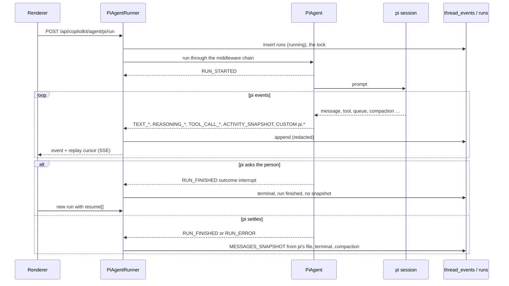

# AG-UI events

The chat runs on [AG-UI](https://docs.ag-ui.com): the backend turns what pi does into AG-UI events, stores them, and
streams them to CopilotKit in the renderer. This page follows one run from the request to the screen, lists every event
pi-kit emits, explains how a thread is replayed after a reload, and closes with a review of the pipeline. Background
agents use the same machinery under the agent id `pi-bg`; they have [their own page](background-agents.md).

## The pieces

| Layer | Where | Role |
| --- | --- | --- |
| HTTP | `apps/backend/src/agui/agui.controller.ts` | `ALL /api/copilotkit/*`: turns the Express request into a fetch `Request` and pipes the SSE body chunk by chunk |
| Runtime | `agui.service.ts` | `CopilotRuntime` with the agents `pi` (`PiAgent`) and `pi-bg` (`BgAgent`), the runner `PiAgentRunner`, A2UI and Open Generative UI on `pi` |
| Agent | `pi-agent.ts` | Maps pi session events to AG-UI events; owns interrupts, resume, steer and follow-up, followed turns and the MCP App relay |
| Middleware | `run-with-middleware.ts` | Runs the agent's middleware chain (A2UI actions, Open Generative UI) without CopilotKit's client-side state reducer |
| Runner | `pi-agent-runner.ts` | Replaces `InMemoryAgentRunner`: the run lock, the event log, live fan-out, connect and hydration, stop, the end-of-run snapshot, compaction |
| Mapping | `libs/shared/pi-adapter` (`map.ts`, `ui-events.ts`, `event-log.ts`) | Pure functions: `mapEvent`, `mapUiEvent`, `interruptFinished`, `closeRun`, `compactableIndices` |
| Storage | `apps/backend/src/db/event-log.repository.ts` | `thread_events` (the log) and `runs` (one row per run; the partial unique index `runs_one_active` is the lock) |
| Renderer transport | `libs/chat/data/src/lib/thread-replay-agent.ts` | A CopilotKit agent that asks for hydration, sends the replay cursor and records checkpoints |
| Renderer state | `libs/chat/data/src/lib/chat/with-chat-events.ts`, `thread-replay-cache.store.ts` | Applies the `pi.*` custom events; caches each thread's messages, state and interrupts |

## A run

A run belongs to the thread, not to the HTTP request: closing the window unsubscribes the client and the run goes on.

`PiAgent.run` handles five kinds of run:

1. **Prompt.** The newest user message (or an A2UI action turned into a prompt). Records the review batch and skill
   chips as `pi.review` / `pi.skills` activities, expands `@file` references, then prompts pi.
2. **Queued input.** pi is streaming and `forwardedProps.streamingBehavior` is `steer` or `followUp`: the text goes to pi's
   queue and the run ends at once. These requests skip the lock and are not logged.
3. **Resume.** `input.resume[]` answers interrupts. The whole batch is validated (no duplicates, ids must be pending,
   payloads must fit the dialog), the stream is attached before answering so nothing is lost, and dialogs still open
   are advertised again. Background-agent questions (`agent-question:<agentId>:<questionId>`) are answered and end at once.
4. **Followed turn.** pi started a turn by itself (a steer that arrived at the end, an extension); the runner opens a
   run with `forwardedProps.followTurn` so it streams like any other.
5. **MCP App relay.** `forwardedProps.__proxiedMCPRequest` from an app's iframe goes to `McpService.relay`, which allows
   only `ui://` reads and app-visible tools.

**Stop** aborts pi (plugins, open dialogs, the session); pi settles and the run ends with
`RUN_FINISHED { outcome: cancelled, result: { aborted: true } }`. Stopping while suspended at an interrupt dismisses the
dialogs. **Errors:** a model error becomes `RUN_ERROR` when pi settles; an exception in the agent, a stream that ends
without a terminal event (`INCOMPLETE_STREAM`) or a failed write (`EVENT_LOG_ERROR`) end the run through `closeRun`,
which closes open blocks and marks running tools aborted. At startup, every `running` row left by a crash is closed the
same way.

## Events

### Standard events

| Event | Produced by | Notes |
| --- | --- | --- |
| `RUN_STARTED` | `PiAgent`, synthetic runs, hydration | The stored copy carries the newest user message as `input.messages` |
| `RUN_FINISHED` | `onSettled`, interrupts, synthetic runs | `outcome.type` is `success`, `cancelled` or `interrupt` |
| `RUN_ERROR` | `onSettled`, `fail`, `closeRun` | Codes: `error`, `busy`, `expired`, `invalid_resume`, `aborted`, `INCOMPLETE_STREAM`, `EVENT_LOG_ERROR` |
| `TEXT_MESSAGE_START` / `CONTENT` / `END` | `map.ts` | The first text block takes the assistant id, later ones `<id>:<index>` |
| `REASONING_START`, `REASONING_MESSAGE_*`, `REASONING_END` | `map.ts` | Timestamps give "Thought for Ns" |
| `TOOL_CALL_START` / `ARGS` / `END`, `TOOL_CALL_RESULT` | `map.ts`, `closeRun` | |
| `ACTIVITY_SNAPSHOT` | `map.ts`, `ui-events.ts` | `pi.tool`, `pi.bash`, `pi.diff`, `pi.compaction`, `pi.turn_usage`, `pi.review`, `pi.skills`, `pi.widget`, `open-generative-ui`, `a2ui-surface`, `mcp-apps`; always `replace: true` |
| `ACTIVITY_DELTA` | CopilotKit's Open Generative UI middleware | |
| `MESSAGES_SNAPSHOT` | The runner at the end of a run, after a branch move, when the log is rebuilt | Built from pi's session file; carries pi entry ids |
| `SUBAGENT_STARTED` / `FINISHED` | `pi-agent.ts` | Wraps `agent_spawn` results and background-agent messages |

`STATE_SNAPSHOT` / `STATE_DELTA` are understood by hydration but pi-kit never produces them.

### Custom events

The names are registered in `libs/shared/protocol/src/custom-events.ts`; the renderer applies them in
`with-chat-events.ts` unless noted.

| Name | Payload | Source | What the renderer does |
| --- | --- | --- | --- |
| `pi.compaction` | `{ phase: 'start' \| 'end', tokensBefore?, tokensAfter? }` | pi compaction | Compacting flag; refreshes stats at the end |
| `pi.queue` | `{ steer, followUp, steerTexts?, followUpTexts? }` | pi `queue_update` | Queue bar |
| `pi.retry` | `{ attempt, maxAttempts, reason }` | pi auto-retry | Retry banner |
| `pi.model` | `{ provider, modelId, thinkingLevel? }` | Model change | Refreshes stats |
| `pi.tree` | `{ leafId, changed }` | Entries appended, branch moves | Marks the session tree stale |
| `pi.status` | `{ key?, text }` (empty text clears) | `ctx.ui.setStatus` | Status line |
| `pi.notify` | `{ level, text }` | `ctx.ui.notify` | Toast, only when fresh |
| `pi.usage` | `{ input, output, cacheRead, cacheWrite, cost, contextTokens? }` | Assistant message end | Cost, tokens, context meter |
| `pi.session_info` | `{ name? }` | pi session name | Refreshes the thread list |
| `pi.title` | `{ title }` | `ctx.ui.setTitle` | Window title |
| `pi.composer` | `ComposerRegistration` (`action`, `suggestion`, `remove`) | Extensions, through `UiBridge` | Composer actions and suggestions |
| `pi.replay` | `{ reset, running? }` | `connect` (both runners) | Clears messages and cache on `reset`, restores cached interrupts otherwise |
| `pi.thread.hydrate` | `ThreadHydration { messages, state, running?, view, composers, title? }` | `connect` | Applies the whole thread in one mutation |
| `pi.replay.checkpoint` | The cursor | Inserted by the renderer itself | Records the cache entry |

**Interrupts** are not custom events: they are `RUN_FINISHED.outcome.interrupts[]`, each
`{ id, reason: 'pi.ui.<method>', message, toolCallId?, responseSchema, metadata }`, and the answer comes back as
`RunAgentInput.resume[]`.

## Replay and persistence

pi's JSONL session file is the source of truth. The event log is a cache that adds what the file lacks: streamed
activities, usage, aborted markers, interrupts and composer registrations. Every run that is not an interrupt ends with
a `MESSAGES_SNAPSHOT` built from the file, and a log older than the file is rebuilt from it.

- **Sequence numbers.** `thread_events.seq` is `AUTOINCREMENT`: global, increasing, with gaps between threads, never
  reused. The cursor is `<generation>:<seq>`, where the generation is a per-thread UUID kept in memory; it changes
  when the log is cleared and when the backend restarts, so a stale cursor means a full refresh.
- **Connect.** `PiAgentRunner.connect` rebuilds the log if pi's file is newer (`ensureCurrent`), flushes composer
  registrations, closes an interrupt no live prompt owns, then sends `pi.replay`. With the hydrate header (the
  renderer always sends it) it sends `RUN_STARTED`, one `pi.thread.hydrate` built from the whole log
  (`thread-hydration.ts`) and, when idle, a `RUN_FINISHED` that copies the last outcome. Without it, it replays the raw
  events after the cursor. Then it follows the live run.
- **Compaction** (`log-compactor.ts`). After a run ends, events before the newest snapshot are reduced to run
  boundaries, block starts and ends, tool results and custom events: older snapshots, activities (except `pi.widget`)
  and the deltas of finished blocks go. A log over 2,000 rows keeps only the newest 10 runs; composer registrations held
  by deleted runs are appended again. Interrupt runs are never compacted.
- **Redaction.** `RedactionService` redacts every string before it is written; live events go to the client
  unredacted and the renderer redacts when it draws.
- **Renderer cache.** `ThreadReplayAgent` restores a thread's cached messages, state and interrupts at once, connects
  with its cursor, and records a checkpoint after every event that carries one. Entries expire after 15 minutes idle,
  or when the heap is above 80 %.

## People in the loop

Dialogs come from extensions (`ctx.ui.confirm`, `select`, `input`, `editor`), the built-in `ask_user` tool and MCP
sign-in prompts. All go through `UiBridge.ask`, which stamps the source, the running tool and the timeout. While a run is
attached, dialogs are batched for 30 ms and the run ends with an interrupt; pi keeps waiting inside its prompt. The
renderer's `pk-interrupts` draws one block per dialog kind, plus background-agent questions from the thread state. The
answer starts a new run with `resume`. The backend does not enforce timeouts: the renderer counts down and dismisses an
expired dialog.

## Generated UI

| Kind | Produced by | Activity | Rendered by |
| --- | --- | --- | --- |
| A2UI | pi's `render_a2ui` tool (`details.a2ui_operations`); clicks come back as A2UI actions and become prompts | `a2ui-surface` | CopilotKit's A2UI renderer with pi-kit's catalog (`libs/chat/feature-genui`) |
| Open Generative UI | `generateSandboxedUi`; the middleware streams snapshots and deltas while arguments arrive | `open-generative-ui` | A sandboxed iframe from `/api/genui-sandbox/frame.html` |
| MCP Apps | A tool result whose server and tool link a `ui://` resource | `mcp-apps` | `feature-genui`'s MCP App host; the app's own requests are relay runs |

`sessionToMessages` rebuilds all three from the session file, so compaction may drop the streamed activities.
