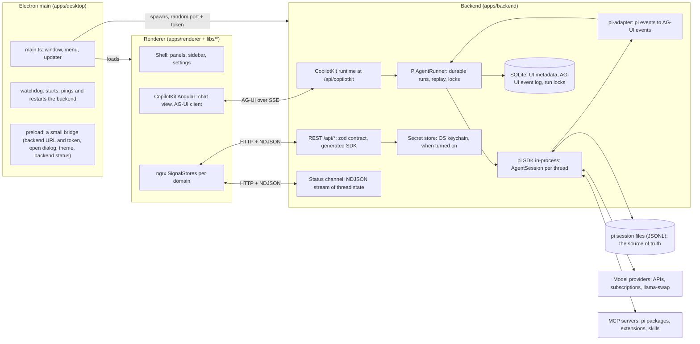
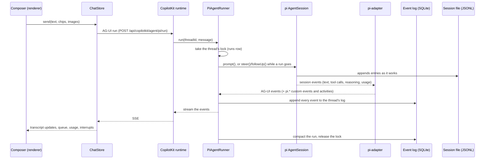
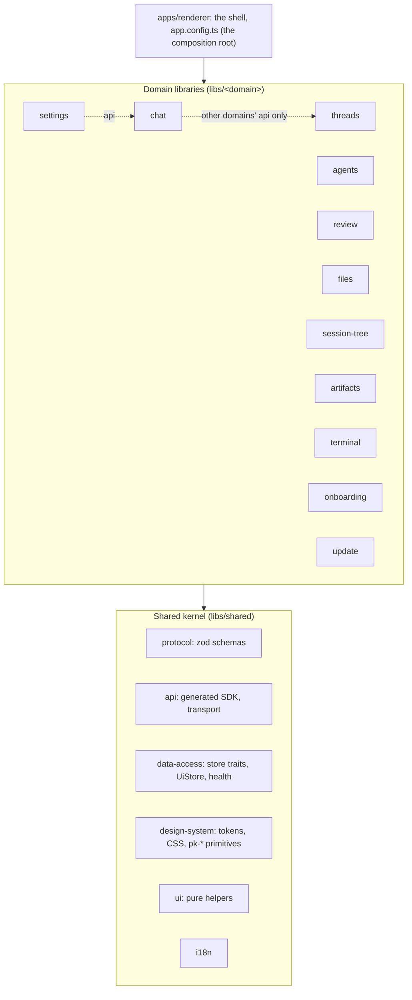
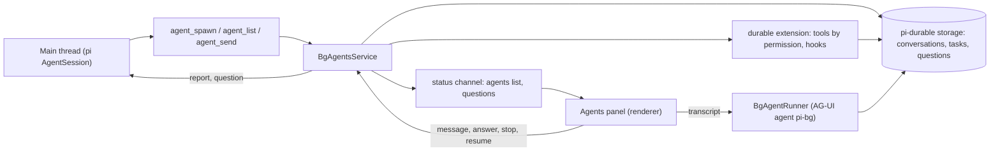

# Architecture

pi-kit is three processes and one agent. Electron main owns the window and the lifetime of the backend; the Angular renderer is
the window's page; the NestJS backend runs pi's SDK in-process and is the only thing that touches the file system, the network and
the keychain. The renderer and the backend talk over HTTP on the loopback interface, with a token minted per launch
([ADR-0007](adr/0007-local-security.md)).

## The three processes

**Electron main** (`apps/desktop`) creates the window, picks a free loopback port and a random token, starts the backend as a child
process with both in its environment, and keeps it alive: a watchdog pings it and restarts it when it stops answering, and the
renderer reconnects when the backend comes back ([ADR-0013](adr/0013-packaging-crash-recovery-and-updates.md)). The
preload script exposes only what the page cannot do itself: the backend's URL and token, the native open dialog, the colour
scheme, the backend's status, the microphone permission, the tray, the browser artifact's viewport and a few view preferences
kept on disk.
Packaging, code signing and the in-app update of pi-kit itself live here too.

**The renderer** (`apps/renderer` and the libraries under `libs/`) is one Angular page with no route table: the chat page in the
middle, the thread sidebar on the left and one side panel on the right, switched by `UiStore`. State is in ngrx SignalStores
([ADR-0024](adr/0024-ngrx-signal-store.md)); the transcript and composer are CopilotKit's Angular components with pi-kit's own slots
([ADR-0021](adr/0021-copilotkit-components-first.md)). The renderer never
reads a file or calls a model: everything comes from the backend over the generated, typed SDK
([ADR-0027](adr/0027-api-contract-zod-swagger-typed-client.md), [ADR-0027](adr/0027-api-contract-zod-swagger-typed-client.md)).

**The backend** (`apps/backend`) is a NestJS application with one folder per domain (`threads`, `session`, `agui`, `bg-agents`,
`settings`, `setup`, `mcp`, `learn`, `worktree`, `terminal`, `browser`, `db`, `secrets`, ...). It hosts the CopilotKit runtime
([ADR-0002](adr/0002-ag-ui-over-copilotkit-runtime.md)) with pi-kit's own `AgentRunner`, runs pi's SDK in-process ([ADR-0001](adr/0001-pi-as-the-agent.md)), keeps
SQLite for what pi does not store ([ADR-0003](adr/0003-pi-sessions-are-the-source-of-truth.md)), and holds the secrets
([ADR-0019](adr/0019-secrets-at-rest.md)). `pi-kit-secret` (`apps/secret-cli`) is the keychain helper pi's own configuration calls.

## What a turn goes through

A run belongs to the thread, not to the HTTP request: a client that closes the window or reloads does not stop it, and a client
that connects later replays the log from a cursor and then follows the live feed
([ADR-0010](adr/0010-durable-threads.md), [ADR-0032](adr/0032-thread-hydration-and-virtual-transcript.md),
[ADR-0032](adr/0032-thread-hydration-and-virtual-transcript.md)). A thread that pi started by itself (an extension's turn, an
agent's report) is announced over the status channel, and the renderer joins it the same way.

AG-UI is extended in two places ([ADR-0005](adr/0005-custom-events-and-activities.md)): `Custom` events carry pi's signals
(`pi.usage`, `pi.tree`, `pi.queue`, ...) and `Activity` messages carry stateful surfaces (a tool call with its status, a diff, a
compaction marker, generated UI). Extension dialogs (`confirm`, `select`, `input`, `editor`) become AG-UI interrupts that the
transcript answers in place ([ADR-0025](adr/0025-human-in-the-loop-and-the-queue.md)).

## The renderer's layers

Every domain is the same five kinds of library: `api` (what other domains may import), `feature-*` (lazy entries, one per chunk),
`ui` (presentational), `data` (SignalStores and generated operations) and `util` (pure functions). A lint rule enforces the import
directions ([ADR-0026](adr/0026-domain-structure-and-boundaries.md)); [Repository structure](structure.md) has the tree and the
rule table. Where two domains need each other, one side declares a **port** (an abstract class in its `data`) that the
composition root provides from the other's store, and a lazy chunk reaches into another domain's page through a **slot** (an
injection token holding a loader).

Two stores carry most of the live state. `ThreadsStore` follows the status channel, an NDJSON stream of every thread's state
(running, waiting, context fill, outcome, the questions of its agents) and hands each line to the stores of other domains that live
on it. `ChatStore` is CopilotKit's agent store wrapped with pi-kit's state: the transcript blocks and turn model, the composer
(draft, chips, the `/` menu, the queue), interrupts, usage. The Agents panel instantiates a second `ChatStore` on the AG-UI agent
`pi-bg`, so a background agent's transcript is drawn by the same code as a thread's.

## Background agents

A thread may spawn durable background agents ([ADR-0033](adr/0033-durable-background-agents.md)). They run on `pi-durable`, a
harness that commits every model turn, tool call and task to storage before it is shown, so an agent survives a restart of the
backend and goes on where it stopped. The main agent spawns one with a brief, a role and a permission mode (`read-only`, `edit`,
or `isolated` in a worktree of its own); the agent reports back into the thread, asks the main agent or the user when it is
blocked, and shows its turns, tokens and spend as it goes; it has no budget or cap of its own.

## Where things persist

| What | Where | Why |
|---|---|---|
| Conversations, branches, compactions | pi's session files (`~/.pi/agent/sessions/`) | pi and the command line read the same files ([ADR-0003](adr/0003-pi-sessions-are-the-source-of-truth.md)) |
| The AG-UI event log, run locks, thread metadata, feedback, terminal screens | SQLite in pi-kit's data folder | durable runs and replay ([ADR-0010](adr/0010-durable-threads.md)) |
| API keys, connector tokens | the OS keychain when credential storage is on (Settings › Advanced; off on a fresh macOS profile), otherwise pi's own 0600 files | never in a project file ([ADR-0019](adr/0019-secrets-at-rest.md)) |
| Models, providers, MCP servers, packages, skills | pi's own configuration files | pi-kit edits them the way pi documents |
| Background agents | pi-durable's storage, `bg-agents.sqlite` in pi-kit's data folder, indexed by the `bg_agents` table | an agent outlives the process ([ADR-0033](adr/0033-durable-background-agents.md)) |
| Window state, view preferences | `localStorage` of the renderer; in the desktop app a few (theme, pinned chips, graph folds) are mirrored to a file by Electron main | per machine, not worth a round trip |

## Local models and connectors

The guided local runtime ([ADR-0030](adr/0030-guided-local-model-runtime.md)) installs `llama.cpp` and `llama-swap`, downloads
models, writes the llama-swap configuration and, since 0.8, starts and stops the llama-swap process from the app and repairs a
configuration whose files or launchers went missing. Connectors ([ADR-0018](adr/0018-connectors.md)) are MCP servers with a sign-in
flow; they are written into pi's `mcp.json` with their secrets in the keychain. pi packages that ship with the app
(`@pi-kit/learn`, `@pi-kit/meat-proxy`, `@pi-kit/computer-use`) are ordinary pi packages that talk to pi-kit over pi's event bus
([Plugins](plugins.md)).
