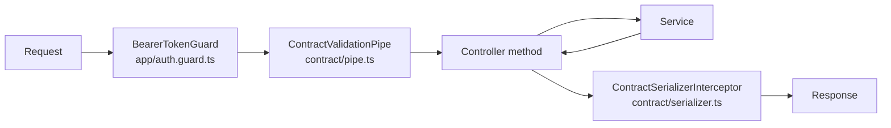

# Backend

`apps/backend` is one NestJS 12 process on Node 24. Electron main starts it with a random loopback port and a
per-launch token, the renderer reaches it over HTTP, and it is the only process that touches the file system, the
network, pi's SDK and the keychain ([Architecture](architecture.md)). This page is the map of that process for the
people who change it: how the code is cut, what each folder owns, what a request goes through, and the steps for the
changes that come up most.

## The shape: one folder per domain, four roles in each

The source is cut by domain, not by layer. `apps/backend/src/<domain>/` holds everything of one concern: its
controllers, its services, the pure functions they call, and the module that wires them. Inside a folder the files
play the same four roles everywhere, so a reader who knows one folder knows them all. Under the folders sits a shared
kernel that every domain may import and that imports no domain. The reasoning, what NestJS itself recommends, what was
measured in the code and the two deviations that are tolerated are in
[ADR-0034](adr/0034-backend-domain-folders-four-roles.md); in short, the backend is an adapter around pi, SQLite, git
and the keychain whose weight is orchestration, so feature folders with four roles are the right cut and a
`domain / application / infrastructure` layer per folder would move files without adding a boundary anything crosses.

Four of the thirty folders drawn as columns; the others follow the same shape, only smaller. Every slice stands on
the shared kernel.


The four roles, with the file suffix that names each:

| Role | File | What it does | What it must not do |
|---|---|---|---|
| Controller | `*.controller.ts` | Names the route, parses the request against a protocol schema, calls one service method, returns a value the response schema describes. | Hold logic. A controller method is three to six lines. |
| Service | `*.service.ts` | The behaviour of the domain: orchestration, pi calls, git, the file system, subscriptions to other services. One `@Injectable()` class per concern. | Import another domain's internals. It injects what the other module exports. |
| Pure functions | plain names (`thread-state.ts`, `outcome-rules.ts`, `questions.ts`) | The decisions that need no I/O: state machines, rules, parsers. Tested without a database or pi. | Import Nest or a service. |
| Repository | `*.repository.ts` | One table or two: the row type, the SQL, the mapping between the two. Lives in `db/`, not in the domain, because every repository shares one connection and one schema file. | Contain a decision. A repository reads and writes. |

Three facts about the folders that are easy to get wrong:

- **A folder is a module.** `<domain>.module.ts` lists the folder's controllers and providers, imports the modules it
  needs and exports only the services another module injects. `app/app.module.ts` imports every feature module; that
  list is the one place a new domain is registered. Four modules are `@Global()` and nothing else should be: config,
  the secret store, the secrets policy and the desktop bridge, because the database needs the store before any
  module initialises and every service may need the config.
- **Domains reach each other through exports.** `bg-agents` injects `ThreadsService`, `learn` injects `AguiService`,
  `score` injects `LearnService`. The import graph has no cycle and no `forwardRef`. The few cross-folder imports
  that are not a service are pure helpers: `worktree/worktree-git.ts` and `worktree-paths.ts`, `threads/session-files.ts`,
  `coordination/leases.ts`, `bg-agents/agent-tools.ts` (the pi extension the `pi` folder installs in every session).
- **Two folders have no module of their own.** `worktree/` holds `WorktreeService` and its helpers but is provided and
  exported by `ThreadsModule`, and its routes are `threads/worktree.controller.ts`. `plugins/` is one abstract class,
  `PiKitPackage`, that `learn`, `score` and `computer-use` extend.

## What a request goes through

Every HTTP request takes the same path. The pieces are global, registered once, and a controller only names its
schemas.



**The guard.** `APP_GUARD` in the root module rejects every request without `Authorization: Bearer <PI_KIT_TOKEN>`,
compared in constant time. `@Public()` exempts a route; three routes use it: the generated-UI sandbox frame and the MCP
App sandbox proxy, both iframe pages that cannot send a header, and the development-only token route. The document
marks them `security: []`.

**The pipe.** A parameter that names a schema is parsed with it, so the handler receives the parsed value with
defaults applied and unknown keys dropped. A missing body counts as `{}` where a schema is named, so an action route
without a payload needs none. A rejected request is a 400 whose `message` lists one `path: reason` per problem. The
log line names paths, never values; a field marked `.meta({ secret: true })` in the schema is printed as `[secret]`.

**The controller.** This is the whole of a typical route, from `threads/threads.controller.ts`:

```ts
@Get('threads')
@ApiOperation({ summary: 'List threads', description: 'Lists the threads of one project folder, or of every project without `workspace`.' })
@Responds(ThreadSummarySchema, { array: true })
list(@Query({ schema: ListThreadsQuerySchema }) query: z.infer<typeof ListThreadsQuerySchema>): ThreadSummary[] {
  return this.threads.list({ workspace: query.workspace || undefined, includeArchived: query.archived === '1' || query.archived === 'true' });
}
```

`@Body({ schema })` and `@Query({ schema })` are Nest 12's Standard Schema parameters; zod 4 implements that
interface, so there are no DTO classes and no `class-validator`. The three decorators of `contract/responds.ts`
describe the answer once for three readers:

| Decorator | OpenAPI | Runtime | Compiler |
|---|---|---|---|
| `@Responds(schema, { status?, array? })` | the response of the operation | the serializer parses the result with it | the method must return what the schema describes |
| `@Fails({ 404: 'There is no such thread.' })` | the error responses, each with a sentence, on the shared `Problem` body | nothing (the handler throws the exception) | nothing |
| `@Streams(lineSchema, description, contentType?)` | a string response whose `x-line-schema` points at the component of one line | nothing (the handler writes the stream itself) | nothing |

**The serializer.** A handler marked `@Responds` has its result parsed with its schema, so the answer carries
exactly what the schema names. A result that does not match is a bug in the backend: in development it is logged
and answered with a 500 so the drift is seen the day it is made; in production it is logged and sent as it is.

**Errors.** A service or controller throws Nest's `HttpException` subclasses (`NotFoundException`,
`ConflictException`, `BadRequestException`) and the default filter turns them into the `Problem` body of
`libs/shared/protocol/src/problem.ts`: `statusCode`, `message` (a sentence, or the list of `path: reason`), `error`.
One domain, `browser`, maps a typed domain error to HTTP in a filter of its own (`browser-exception.filter.ts`),
because the same error type is also returned to pi tools, which need it untouched.

**Streams.** Eight operations keep the connection open: the thread status channel, the folder watcher, a shell
command's output, a terminal, a provider sign-in, update progress and two transcription streams. A stream handler
takes `@Res() res`, writes the headers itself, writes one JSON value per line (or one SSE event), sends an empty or
`ping` line every 20 seconds so proxies keep the connection, and unsubscribes in `res.on('close')`. The pattern is
`ThreadsController.events` in `threads/threads.controller.ts`; copy it.

**The document.** `GET /api/openapi.json` serves the OpenAPI 3.1 document built from the decorators above, behind the
token like every route; `dev:web` also mounts the Swagger UI at `/api/docs`. `pnpm run api:openapi` builds the
backend, scans the module graph without starting it (no database, keychain or pi folder is touched) and writes
`doc/api/openapi.yaml` (208 paths today) and the typed client in `libs/shared/api`. `pnpm run check` regenerates
both and fails on a diff, so the committed contract is never behind the code
([ADR-0027](adr/0027-api-contract-zod-swagger-typed-client.md), [ADR-0027](adr/0027-api-contract-zod-swagger-typed-client.md)).

Two surfaces are not REST and not in the document: the AG-UI run endpoint that CopilotKit's runtime serves at
`/api/copilotkit/*` (`AguiController` forwards Express to the runtime's fetch handler and pipes the SSE run stream),
and `GET /api/dev/token`, which exists only under `NODE_ENV=development`.

## The process lifecycle

`main.ts` runs in this order, and the order matters: `telemetry-off` (environment variables CopilotKit reads at
import time) and `fatal-diagnostics` (a stack line on fd 2 for an uncaught exception) are imported first; then
`loadConfig()` reads and validates the environment and refuses to start without a token or a port; then
`NestFactory.create`, the unlimited JSON body, shutdown hooks on `SIGINT` and `SIGTERM`, the `api` prefix, CORS for
the renderer's origins, `mountContract`, and `listen` on `127.0.0.1`.

Inside Nest the work of a service is placed by hook, and the placement is a convention worth keeping:

| When | What goes there | Examples |
|---|---|---|
| Provider factory | Things that must exist before anything else can be constructed. | `SECRET_STORE` selects the store from the saved storage preference; `DatabaseService.create` opens the file (keyed when protected storage is on) and applies the schema. |
| Constructor | Nothing that can fail. Fields, the logger. | every service |
| `onModuleInit` | Subscriptions between services and registration of hooks into pi sessions. | `ChangesService` subscribes to tool starts; `CoordinationService` registers itself with `PiSessionService`; `BgAgentsService` takes the owner lock and opens the durable harness. |
| `onApplicationBootstrap` | Work that needs every module initialised and may take time; never awaited when listening must not wait for it. | `ThreadsService.reconcile()` scans the session files; `UpdateService` schedules the first update check; `LocalRuntimeService` restarts a saved llama-swap. |
| `onModuleDestroy` | Timers cleared, subscriptions released, processes and connections closed. | every service that holds one |
| `onApplicationShutdown` | What must outlive every module's cleanup. | `DatabaseService` closes the connection here, after session disposal. |

Nest 12 calls the hooks by component hierarchy level, so a service must not rely on another module's
`onModuleInit` having run inside its own; the subscriptions above are all set up through methods that are safe to
call in any order (`PiSessionService` keeps listener sets, nothing is dispatched at registration).

`ParentProcessMonitor` (in `app/`) polls the parent pid Electron passes and sends the process `SIGTERM` when the
parent is gone, and arms a grace deadline on `SIGINT`/`SIGTERM` so a shutdown hook that hangs cannot keep the
process alive ([ADR-0013](adr/0013-packaging-crash-recovery-and-updates.md)).

## The shared kernel

**`pi/`: the SDK.** `load-pi.ts` is the only file that loads the pi packages. pi is ESM-only and the backend is a
CommonJS bundle, so it uses a native dynamic `import()`, and it decides once which copy loads: `PI_KIT_PI_DIR`, pi's
managed install, or the copy bundled with the app ([ADR-0023](adr/0023-pi-updates-in-app.md)). `PiSessionService`
(`pi-session.service.ts`) is the one door to pi: it opens one `AgentSession` per thread, created like the CLI creates
its own so the tool set matches, and adds eight extensions in a fixed order: MCP (with the transport tap the MCP
panel reads), codemode, tool search, coordination, browser, the background-agent tools, generative UI and `ask_user`.
Everything else in the backend talks to pi through this service: prompts and steering, the queue, dialogs, models,
compaction, the session tree, and the listener registries other services subscribe to (`onToolStart`,
`onTreeChanged`, `onDialogsChanged`, `onSkillsUsed`, `onTurnStarted`). `ui-bridge.ts` is the host side of pi's
extension UI: a `select`, `confirm`, `input` or `editor` call becomes a pending interrupt the transcript answers in
place ([ADR-0025](adr/0025-human-in-the-loop-and-the-queue.md)). The folder also holds project trust
(`trust.service.ts`), pi's settings and sign-in (`pi-config.service.ts`), the resource inventory
(`resources.service.ts`), the plugin bus (`pi-plugin.service.ts`) and the model runtime wrapper that lists a
subscription's live model catalog (`model-runtime.ts`).

The facade delegates open admission, session construction, registration, disposal and shutdown to the internal
`SessionLifecycle` owner (`session-lifecycle.ts`). It exposes a read-only registry view to the facade and shares
one teardown path for disposal and sessions that finish opening after shutdown. `SessionModels`, `SessionMcp`
and `SessionQueue` own their session operations; `session-resources.ts` projects live command/chip resources,
and `session-ui.ts` binds the extension UI before use. Application listener policy stays in the facade. These
are implementation owners in the existing folder, without additional Nest modules or dependency-injection layers.

**`db/`: SQLite.** `DatabaseService` owns the one connection (`pi-kit.sqlite` in the data folder), in WAL mode, and
applies the SQL files of `db/migrations/` in name order at construction, each once, all in one `BEGIN IMMEDIATE`
transaction (two processes opening a fresh file do not both create the tables), recorded in `schema_migrations` with a
hash of the SQL (comments and spacing left out). The schema is one file, `0001_init.sql`: the numbered migrations were
squashed into it before 1.0. A database that recorded a file the folder no longer has, or a different text of one, came
from another pi-kit version and is refused with a message to delete it. `MaintenanceRepository` prunes what grows with use
once a day: attendant activity after 90 days, finished runs but each thread's newest, settled follow-up prompts but each
thread's newest, terminal screens of folders that are gone or unopened for 30 days, and replay logs whose thread or
background agent is gone. Deleting a thread is one transaction in `ThreadsRepository.delete`, used by both the Delete
action and the pass that finds a session file gone; background agents follow through `ThreadsService.onDeleted`.
Whether the file is encrypted follows the storage preference (Settings › Advanced, kept in `<data dir>/security.json`):
with credential storage on, it is encrypted at rest (`better-sqlite3-multiple-ciphers`) with a random key kept in
the store as `pi-kit/db` ([ADR-0019](adr/0019-secrets-at-rest.md)); a fresh macOS profile starts plain. A file that
is already encrypted stays encrypted and needs its original key; nothing is decrypted or replaced on failure.

`EventLogRepository` uses Drizzle on `DatabaseService.orm`, which shares the same connection.
SQLite generates replay event IDs; IDs increase within each thread and may have gaps when other threads write.
The SQL file, not Drizzle, owns the schema.

Twelve repositories each own a table or two and, with `MaintenanceRepository`, are provided and exported by
`DbModule`; the thirteenth lives with its domain:

| Repository | Tables |
|---|---|
| `ThreadsRepository` | `threads`, one row per known pi session |
| `EventLogRepository` | `thread_events` (the AG-UI replay log) and `runs` (the per-thread run lock) |
| `MetaRepository` | `workspaces`, `settings` |
| `ChangesRepository` | `review_comments`, `change_baselines` |
| `AttendantRepository` | `thread_meta`, `attendant_actions`, `thread_suggestions` |
| `FeedbackRepository` | `feedback` |
| `LeasesRepository` | `file_leases` |
| `OutcomesRepository` | `thread_outcomes` |
| `SignalsRepository` | `thread_outside_edits`, `thread_dialog_answers` |
| `SkillDraftsRepository`, `SkillUsesRepository` | `skill_drafts`, `skill_uses` |
| `TerminalReplayRepository` | `terminal_replay` |
| `BgAgentsRepository` (in `bg-agents/`) | `bg_agents`, the index of the durable store |

`RedactionService` runs before text a person typed is kept: titles, previews and exports are masked with the
patterns of [ADR-0019](adr/0019-secrets-at-rest.md).

**`secrets/`: the credential store.** `SecretStoreModule` selects the store at startup and exports it as the
`SECRET_STORE` token: on macOS the Keychain store only when credential storage was turned on or encrypted data
exists (a fresh profile never touches Keychain), elsewhere the OS keyring when there is one; `PI_KIT_SECRET_STORE`
(`macos`, `legacy`, `memory`, `file:<path>`, `none`) overrides it. `SecretsModule` holds the policy: with a store, API
keys go to it and pi's `auth.json` gets the command that prints them (`pi-kit-secret`, `apps/secret-cli`), the
launcher is written to the data folder, and existing plaintext keys move only through the explicit move action in
Settings, never at startup.

**`app/`, `contract/`, `desktop/`.** `app/` is the root module, the config token, the guard, the health route and
the parent monitor. `contract/` is the request path above. `desktop/` is `DesktopBridge`, a correlated
request-and-answer channel over process IPC to Electron main, for what only the shell can do: open a path, reveal a
file, drive the browser artifact, install an app update. It answers "unavailable" when the backend runs without
Electron (`dev:web`, the tests).

**`@pi-kit/protocol`.** The zod schemas and types of every request, response, stream line, AG-UI custom event and
plugin message live in `libs/shared/protocol`, compiled into the backend and the renderer alike. A schema that is a
component of the document carries `.meta({ id })`; a query schema stays inline. A new field in a response starts
here.

## The domains

What each folder owns, its HTTP surface, and what is particular about it. The route prefix is under `/api`.

| Folder | Owns | Routes | Particular |
|---|---|---|---|
| `agui` | CopilotKit's runtime route and `PiAgentRunner`, the durable runner behind it: `run()` takes the thread's lock and appends every AG-UI event to `thread_events`; `connect()` replays the log from a cursor and follows the live run. `thread-hydration.ts` builds the current pi state from the log on the server; `log-compactor.ts` compacts a run after it ends. | `ALL copilotkit/*`, `GET genui-sandbox/frame.html` | A run belongs to the thread, not the request: closing the window does not stop it ([ADR-0010](adr/0010-durable-threads.md), [ADR-0032](adr/0032-thread-hydration-and-virtual-transcript.md), [ADR-0032](adr/0032-thread-hydration-and-virtual-transcript.md)). `AguiService.runHeadless` starts a run with no browser (skill verification). |
| `threads` | The thread list as a cache of pi's session files plus pi-kit's own flags, kept honest by `reconcile()` every 30 s; the status stream every client keeps open; projects; the app's own settings; the worktree routes; outcomes (the base commit a thread started from and whether it was merged, committed or became a PR). | `threads`, `threads/events` (stream), `threads/:id/*`, `workspaces`, `settings`, `threads/:id/worktree/*`, `threads/:id/outcome` | `ThreadStatusService` computes every thread's state (running, waiting, unread, context share) from subscriptions and pushes `snapshot`, `state`, `gone`, `list` lines ([ADR-0015](adr/0015-projects-and-thread-state.md)). |
| `session` | The REST face of an open session: the command list, models and thinking level, compaction, reload, export, stats, the context piece by piece, `!shell` commands as a stream, `@file` search, the Files panel tree and the folder watcher stream, file operations inside a workspace. | `threads/:id/commands|stats|context|usage|model|compact|reload|export|bash`, `models`, `workspaces/:id/files|tree|watch|fs/*`, `threads/:id/queue/*`, `threads/:id/complete|composer` | Everything that is conversation stays in AG-UI; this folder is what the composer needs beside it. `safe-path.ts` keeps every path inside the workspace. |
| `bg-agents` | Background agents of a thread on pi-durable: one harness per backend on `bg-agents.sqlite` (protected like the app database) behind a cross-process owner lock with fencing epochs, the index table, the `pi-bg` AG-UI agent whose events land in the same log as the threads', the `agent_*` tools every main session carries, questions routed to the user, holds after a crash and a crash-loop limit. | `threads/:id/agents`, `threads/:id/agents/:agent/message|answer|resume|stop`, `DELETE threads/:id/agents/:agent` | Only five adapter files (`bg-agents.service.ts`, `agent-questions.ts`, `durable-storage.ts`, `agent-extension.ts`, `agent-events.ts`) and their specs may import pi-durable or chord; a lint rule enforces it ([ADR-0033](adr/0033-durable-background-agents.md)). The service disables itself and logs a warning when the store cannot be opened, and the backend still starts. |
| `changes` | The Changes panel and review mode: a "This thread" source built from pi's edits against baselines captured at the first `edit` or `write`, a "Working tree" source from git, review comments, revert and stage; the git status that decorates the Files panel. | `threads/:id/changes`, `threads/:id/changes/:file`, `threads/:id/revert|stage`, `threads/:id/review-comments`, `workspaces/:id/status` | `touched.ts` reconstructs a baseline by undoing patches, pure. |
| `coordination` | File leases recorded at `edit`/`write` tool starts, and the "other agents in this workspace" section every session is given, with notices for files another thread changed. | `threads/:id/coordination` | Soft: it blocks nothing ([ADR-0020](adr/0020-worktrees-and-coordination.md)). Leases expire after 30 minutes and are pruned on a timer. |
| `worktree` | A git worktree per thread: create, sync with the base, merge back (merge commit or pull request), hand off, remove; the proposed commit message and a setup script guessed from the lockfile. | (in `threads`) | File changes wait for the thread's run to end. pi only sees a different cwd. |
| `terminal` | One convenience shell per workspace on a pty, kept while the backend runs, its last screen saved for replay. | `workspaces/:id/terminal`, `.../stream` (stream), `.../input|resize` | Not pi's bash tool. |
| `mcp` | The MCP panel: a session's servers, their tools and MCP Apps, the `mcp.json` editor, add/change/remove a server, reconnect, sign-in; the connector catalog that turns a click into an `mcp.json` entry with its token in the credential store; the MCP App sandbox proxy page. | `mcp`, `mcp/servers/:name/*`, `mcp/file`, `connectors/*`, `mcp-sandbox/proxy.html` | Status is read from pi's own `/mcp` command text, parsed by `mcp-status.ts`, which a test pins to pi's format. `mcp-tap.ts` wraps the transports to record tools and resource metadata ([ADR-0018](adr/0018-connectors.md)). |
| `skills`, `packages`, `computer-use` | The person's own skill folders and their `SKILL.md`; pi packages in Settings (list, install, update, remove, search, the Add a package wizard); the opt-in computer-use package and macOS permissions. | `skills`, `skills/file`, `packages/*`, `computer-use/*` | `packages` never runs a package's code. The three bundled packages (`learn`, `meat-proxy`, `computer-use`) are installed into pi's settings once, on first start, by `PiKitPackage`. |
| `browser` | The browser artifact the desktop app keeps per thread, read and driven through `DesktopBridge`; the `pi_browser` tool in `pi/browser-extension.ts` uses the same service. | `threads/:id/browser`, `threads/:id/browser/action` | Answers only when Electron hosts the backend ([ADR-0029](adr/0029-browser-artifacts.md)). |
| `settings`, `secrets` (routes) | pi's settings, provider sign-in as a replayable stream, logout, key validation, keybindings, the resource inventory, trust decisions, session import, diagnostics; the secret store's status, credential storage choice, moving keys, the recovery key, redaction settings. | `pi-settings`, `auth/*`, `providers/*`, `pi-keybindings`, `resources`, `trust`, `workspaces/:id/trust`, `import`, `diagnostics`, `about`, `secrets/*`, `redaction` | The controllers are thin over `PiConfigService`, `TrustService`, `SecretsService`; `DiagnosticsService` is the read-only object the bug-report dialog shows, with nothing secret in it. |
| `setup` | First-run onboarding: detect what is installed, record how onboarding ended, test and save a local model server, the LiteLLM connection, and the local runtime wizard (`LocalRuntimeModule`): hardware, the GGUF catalogue pinned by revision and SHA, cancellable downloads, llama-swap config, process, doctor and repair, one setup job at a time. | `setup`, `setup/*`, `setup/litellm/*`, `setup/local-runtime/*` | The largest folder by routes. `LocalLlamaSwapProcessService` owns only the process it started, never one it found ([ADR-0030](adr/0030-guided-local-model-runtime.md)). |
| `update` | Updates from inside the app: one background job (`pi update --all`, `--models`), a check every six hours, the managed releases and pinning, the restart; the app's own update goes through Electron main. | `update/*`, `update/events` (stream) | Output goes to listeners and to `update.log` ([ADR-0023](adr/0023-pi-updates-in-app.md)). |
| `attendant` | The attendant agent: names threads, keeps one-line summaries, proposes labels for fork points, drafts answers to mechanical questions. Always loaded, idle until turned on. | `attendant`, `attendant/settings|run`, `attendant/suggestions/:id/accept|dismiss` | `AttendantModelPort` is the seam a test replaces; the real one makes a separate no-tools session per request under a cost cap ([ADR-0016](adr/0016-the-attendant-agent.md)). |
| `learn` | Skills learned from finished threads: the host side of the `pi-kit:*` plugin events, the draft state machine (pending, approved, discarded, reopened), approval (the only code that creates a skill folder), verification by replaying the draft from the outcome's base commit in a scratch worktree, the record of learned skills and their uses. | `threads/:id/skill-draft`, `threads/:id/learning-thread`, `skill-drafts/*`, `skills/learned/*` | The analysis itself is the `@pi-kit/learn` package's; the backend stores, decides and draws ([ADR-0028](adr/0028-learning-from-finished-threads.md), [Plugins](plugins.md)). |
| `score` | The Meat Proxy and Vibe scores: the second consumer of the plugin channels (baselines, outside edits, annotate, outcome), hand edits recorded from the watcher while no run was writing, the per-project distribution. | `threads/:id/score`, `threads/:id/score/relabel`, `scores` | Nothing is drawn while the `@pi-kit/meat-proxy` package is not installed; the service polls the install state to follow `pi install` and `pi remove`. |
| `tree` | The session graph: read a thread's tree, an entry, move the leaf, summarise a branch, label an entry. | `threads/:id/tree|entries/:entryId|navigate|summarize-branch|label` | The transcript follows through `PiSessionService.onTreeChanged`; nothing here talks to AG-UI. |
| `transcribe` | Voice input with the Whistle speech model on this machine: engine and model status, a consented pinned download, transcription as one request, as SSE partials, or as live chunks. | `transcribe`, `transcribe/model`, `transcribe/stream` (SSE), `transcribe/live/*` | One request at a time; the model loads on first use and is released after ten idle minutes. `PI_KIT_TRANSCRIBE_ENGINE=fake` is the test engine ([ADR-0017](adr/0017-voice-input-and-model-download.md)). |
| `usage` | Provider usage for Settings, one small adapter per provider, cached for a minute. | `providers/:id/usage` | The credential is read for the call and never kept or logged. |
| `watch` | The shared folder watcher: reference counted per listener, 300 ms debounced batches, FSEvents on macOS and chokidar elsewhere. No routes; the stream is `GET workspaces/:id/watch` in `session`. | | Imported by `threads` (outcomes watch `HEAD`), `session`, `score`. |

## How to extend it

### Add a route to an existing domain

1. **The schema first.** Add or change the request and response schemas in `libs/shared/protocol`. A response schema
   that other schemas nest or that more than one operation returns gets `.meta({ id: 'Name' })`; a query schema
   stays inline. Mark a field that must never be logged with `.meta({ secret: true })`.
2. **The service method.** Put the behaviour in the domain's service. Throw `NotFoundException` or
   `ConflictException` with a sentence a person can read; the renderer shows it as it is.
3. **The controller method.** `@ApiOperation({ summary, description })` (a title and one sentence),
   `@Responds(schema)` or `@HttpCode(204)` with `@ApiNoContentResponse()`, `@Fails({ ... })` for every status the
   method can throw, `@Body({ schema })` or `@Query({ schema })` for the input, and `@ThreadIdParam()` or
   `@WorkspaceIdParam()` when the path has one. The return type is `z.infer` of the response schema; the compiler
   refuses a method that returns something else.
4. **Regenerate the contract.** `pnpm run api:openapi` rewrites `doc/api/openapi.yaml` and the typed client. Commit
   both; `pnpm run check` fails otherwise.
5. **Use it in the renderer** through the generated operation, from a store in a `data` library; never through a
   hand-written fetch ([Repository structure](structure.md#generated-http-api-and-configuration-adr-0027)).
6. **Test the service**, not the route: a `*.spec.ts` next to the service that constructs it with `new` and the
   repositories it needs on a temporary database (`new DatabaseService({ dataDir })` on an `mkdtemp` folder, as
   `threads/threads.service.spec.ts` does). The request path is covered once, by `contract/contract.spec.ts`.

### Add a domain

1. Create `apps/backend/src/<name>/` with `<name>.module.ts`, a controller and a service. Import `DbModule` for
   repositories and `PiModule` for sessions; import another feature module only for a service it exports.
2. Export from the module only what another module will inject. Do not mark it `@Global()`.
3. Add the module to the `imports` of `app/app.module.ts`. That is the whole registration: the guard, the pipe, the
   serializer and the document pick the routes up from the module graph.
4. Give the controller `@ApiTags('<name>')`; the tag groups the operations in the document.
5. Add a `no-restricted-imports` block to `eslint.config.mjs` only if the folder needs a package no other folder may
   use, the way `bg-agents` fences pi-durable.

### Add a table

1. Write `db/migrations/<next number>_<what>.sql` after `0001_init.sql`, plain SQL (it runs once, in name order,
   on every database that has not recorded it). Do not change the SQL of a file that shipped: its hash is recorded,
   and a database made from another text is refused (comments may change freely).
2. Add a repository in `db/`: the `Row` interface, the raw row type with SQLite's column names, one mapping function
   between them, and methods that are single statements or one transaction. Text a person typed goes through `redact()`
   before it is stored (`threads.repository.ts` is the example).
3. Provide and export it in `DbModule`. Nothing else is needed; `DatabaseService` is already open when the
   repository's constructor runs, so prepared statements can be made there.

### Add a stream

Copy `ThreadsController.events`: `@Streams(LineSchema, 'what ends it')` with a line schema that carries
`.meta({ id })`, `@Res() res`, `res.status(200).set(...)` with `application/x-ndjson` (or `text/event-stream`),
`res.flushHeaders()`, a `send` that checks `res.writableEnded`, a subscription taken before the snapshot is written
so a change in between is sent twice rather than lost, a `setInterval` ping, and `res.on('close')` that clears the
interval and unsubscribes. The renderer reads it with `ApiClient.stream`.

### React to what a session does

`PiSessionService` has a listener registry for each thing a domain may need to follow: `onToolStart` (a tool is
about to run; `changes` captures baselines, `coordination` records leases), `onTreeChanged`, `onDialogsChanged`,
`onDialogAnswered`, `onSkillsUsed`, `onTurnStarted`. Subscribe in `onModuleInit`, keep the returned function, call it
in `onModuleDestroy`. `EventLogRepository.onRunChange` tells when a run starts and ends. These registries are the
seam: a domain that needs something from a session that no registry gives adds a registry here, not a direct call
from `pi/` into the domain.

### Give every session a new tool or prompt section

That is a pi extension: a factory in `pi/` (`coordination-extension.ts`, `browser-extension.ts`,
`genui-extension.ts` and `ask-user-extension.ts` are the four shapes: a prompt section, a tool, a tool with a bundled
skill, a tool that opens an interrupt) added to the list in `SessionLifecycle.create()` (`pi/session-lifecycle.ts`). The extension receives a
host hook object the owning service sets with a `set*` method (`setCoordination`, `setBrowser`, `setAgents`), so
the extension stays free of Nest and the service stays the owner of the behaviour.

### Answer a plugin channel

A pi package that ships with the app talks to the backend over pi's event bus ([Plugins](plugins.md)). The host side
is `PiPluginService.register(channels, host)` in the owning service's `onModuleInit`, with the request and reply
schemas in `libs/shared/protocol/src/plugins.ts`. `learn.service.ts` and `score.service.ts` are the two hosts; the
package itself extends `PiKitPackage` (`plugins/pi-kit-package.ts`), which installs it into pi's settings once and
respects a `pi remove`.

### Run work in the background

The pattern is one job at a time, owned by a service: a `running` field, an `AbortController`, listeners that get
status and output lines, a stream route that replays the status and follows, and `onModuleDestroy` that aborts and
awaits. `update.service.ts` (the pi update), `setup/local-runtime.service.ts` (downloads and installs) and
`learn/verify.service.ts` (a replay in a scratch worktree) are three instances. Work that must survive a restart of
the backend is a background agent on the durable harness, not a job.

## Conventions

**Files.** `*.module.ts`, `*.controller.ts`, `*.service.ts`, `*.repository.ts`, `*.filter.ts`; pure helpers carry a
plain name; a spec sits next to the file it tests as `*.spec.ts`. No `dto`, `entity` or `interface` folders: types live beside their one user, schemas in
the protocol library.

**Comments.** Every exported class, interface and non-trivial function carries a TSDoc block that says what it is for
and the decision behind it, in prose, so the file can be read top to bottom. The source has no `TODO` markers; what
is not built is in a decision record. A comment that explains a line sits above it.

**Errors and logs.** Exceptions carry a sentence for the person. The `Logger` is Nest's, named after the class. No
request body, query or credential is ever logged as a value; a rejected request logs its schema paths, and
`redactSecrets(schema, value)` is what may print the rest at debug level.

**Environment.** `loadConfig()` reads `PI_KIT_TOKEN` (required, 16 characters or more), `PI_KIT_PORT` (required),
`PI_KIT_ORIGIN` (CORS, comma separated), `PI_KIT_CWD`, `PI_KIT_DATA_DIR`, `PI_KIT_PARENT_PID` and `NODE_ENV`. The
other `PI_KIT_*` variables are read where they matter and are for development and tests: `PI_KIT_HOME` (a scratch
home for pi), `PI_KIT_PI_DIR` (which pi to load), `PI_KIT_SECRET_STORE` (which credential store, scratch ones in
tests), `PI_KIT_DB_KEY` (a recovery key), `PI_KIT_WORKTREE_ROOT` (where worktrees go), `PI_KIT_RECONCILE_MS`, `PI_KIT_TRANSCRIBE_ENGINE`, `PI_KIT_TRUSTED_CWDS` (ignored
in production), and the `PI_KIT_*_PACKAGE=off` switches that skip a bundled package. `PI_KIT_DESKTOP=1` is what
Electron sets so the desktop bridge opens its IPC channel.

**Tests.** vitest, `environment: node`, `nx test backend`. Specs construct services with `new` and real repositories
on a temporary database; what they cannot have (pi, the desktop, a model) is a stub object or a port class
(`AttendantModelPort`). `Test.createTestingModule` is used only where Nest itself is the subject: the contract, the
body limit, the shutdown order of the database and one route over a real port (`score.service.spec.ts`). A test that needs pi's real behaviour is an end-to-end test
(`pnpm run e2e`, Playwright against `dev:web` with a local model).

**Lint.** The workspace rules plus four from `@darraghor/eslint-plugin-nestjs-typed` (no duplicate decorators,
factory parameters match `inject`, injectable provided tokens, route parameter names match) and, outside specs,
`no-floating-promises`, `await-thenable` and `no-misused-promises`. A promise that is deliberately not awaited is
written `void this.reconcile()` with a comment that says why.

**Build.** One CommonJS esbuild bundle (`nx build backend`, target `node24`) with the native packages external
(`better-sqlite3-multiple-ciphers`, `node-pty`, `@napi-rs/keyring`, `keychain-store`); `apps/backend-runtime`
provisions those per platform for the packaged app. Nest 12's packages are ESM and are loaded through Node's
`require(esm)`; pi and chokidar are loaded with a dynamic `import()`. The second entry of the bundle,
`openapi.js`, writes the document ([ADR-0022](adr/0022-latest-dependencies.md)).
