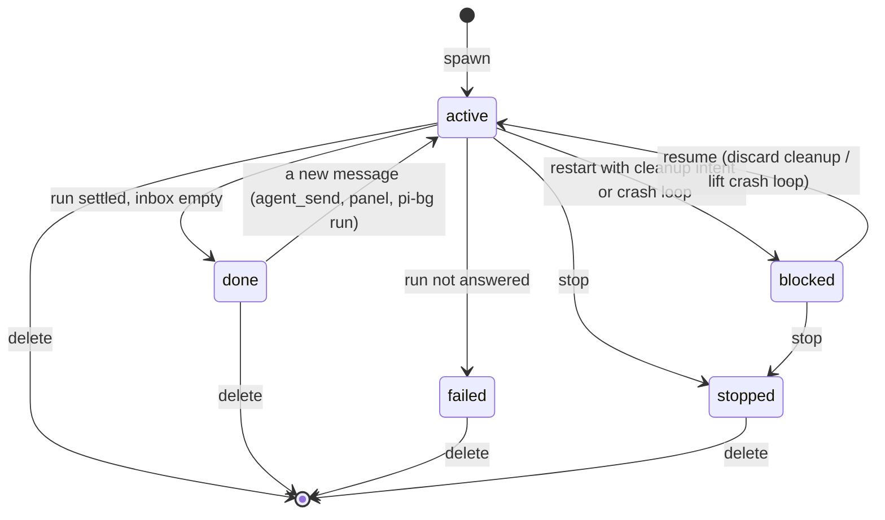
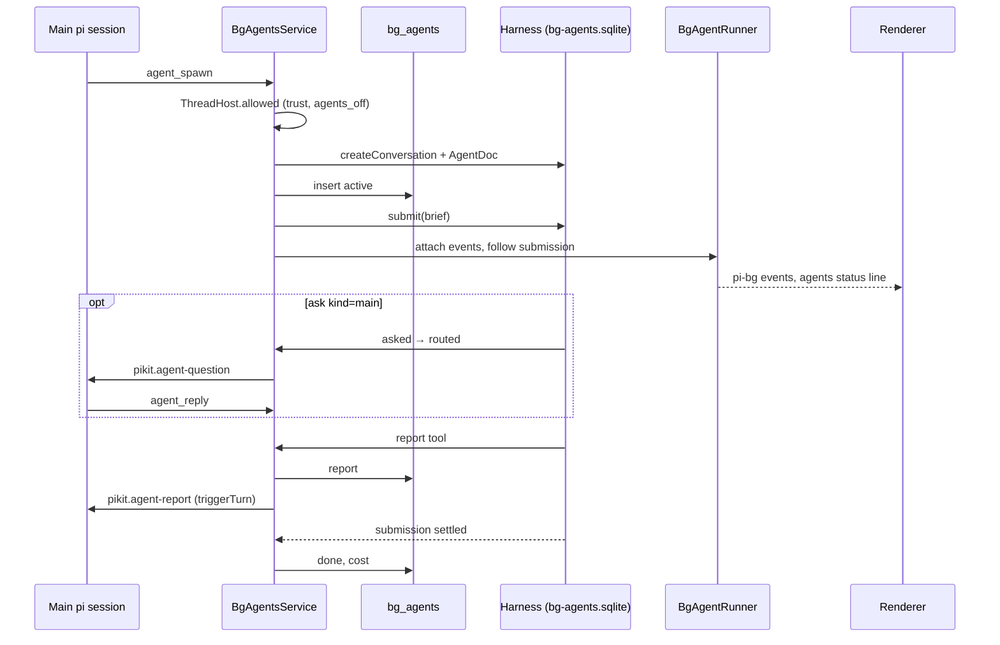

# Background agents

A thread's pi can hand work to **background agents** (subagents): named helpers that run next to the main conversation,
in the same backend, and report back when they are done. This page describes how they work. The decision behind the design
is [ADR-0033](adr/0033-durable-background-agents.md); where the code and that record disagree, this page follows the code
and says so.

## What a background agent is

A background agent is a **pi-durable conversation** (created `ownerless`) that belongs to exactly one pi-kit thread. It
does not run inside the main pi session: the backend keeps one pi-durable `Harness` for all agents, and every agent is a
conversation in it. Its state lives in two places:

| Where | What | Who reads it |
| --- | --- | --- |
| `<dataDir>/bg-agents.sqlite` (the durable store) | The transcript, task state, the `pikit.agent` doc (`AgentRecord`: thread, name, role, brief, permission, worktree, turns, tokens), the `pikit.questions` doc, pi-durable's `pi.usage` ledger | The `Harness`; the source of truth for the run |
| `bg_agents` in `pi-kit.sqlite` | Index and history: thread, name, role, model, permission, brief, submission, status, timestamps, cost, report, `cleanup_json`, `failures_json`, `owner_epoch` | The panel, the main agent's tools, recovery |

The durable store is encrypted with the app database key when there is one. Without a key it is opened in plaintext,
and a plaintext store is encrypted in place once a key is available (`durable-storage.ts`).

The agent runs with the durable extension `pikit.agent` (`bg-agents/agent-extension.ts`):

- tools: pi-durable's `read`, `write`, `edit`, `bash`, plus `report`, `ask`, `agent_send` and `agent_list`;
- a system-prompt section that starts with `pikit-agent: <name>` and tells it what it may do;
- hooks: `beforeRequest` waits on a hold, counts turns and refreshes usage; `beforeTool` / `afterTool` wait on a hold,
  apply the permission mode, tell Changes and the file leases about edits, and record the bash cleanup intent.

## Spawning

Every main pi session loads `createAgentTools` (`bg-agents/agent-tools.ts`). It registers the tools below and a
`background_agents` section of the system prompt, which appears only when agents are available for the thread.

`agent_spawn` takes:

| Argument | Rule |
| --- | --- |
| `name` | 1–40 characters, `^[a-z0-9][a-z0-9-]*$` |
| `role` | 1–80 characters |
| `brief` | The agent's whole context: it does not see the main conversation |
| `permission` | `read-only` (default), `edit` or `isolated` |
| `model` | Optional `provider/modelId`; the session's current model when omitted |

`BgAgentsService.spawn` then:

1. asks `ThreadHost.allowed(threadId)`: the project must be trusted and `workspaces.agents_off` must be 0;
2. reloads the model runtime if `models.json` or `auth.json` changed;
3. creates the conversation and its `AgentDoc` in one transaction;
4. inserts the `bg_agents` row as `active` with the current owner epoch;
5. for `isolated`, creates a git worktree through `ThreadHost.isolate` and stores it in the record;
6. submits the brief (`requestId: spawn:<id>`), stores the submission id, attaches to the event stream and follows the
   submission.

In the main thread the tool result is wrapped as `SUBAGENT_STARTED` / `SUBAGENT_FINISHED` with the id `<agentId>/spawn`
and the spawning tool call as `parentToolCallId` (`agui/pi-agent.ts`), so the transcript shows the agent as a child of
that call.

## Running

- **One harness per backend process.** `BgAgentsService.onModuleInit` opens it. There are no worker processes;
  `bash` children are spawned detached in their own process group so `stop` can kill the whole group.
- **One owner.** `takeOwnerLock` (`durable-storage.ts`) holds a `BEGIN IMMEDIATE` transaction on
  `bg-agents-owner-lock.sqlite` for the life of the process and increments `epoch` in `bg-agents-owner.sqlite`. A second
  backend on the same data folder gets `StoreOwnedError` and has agents off. `bg-agents.lock` is only a diagnostic note
  with the PID. `GET /api/health` reports the state as `backgroundAgents`.
- **Epoch fencing.** Every row update is `UPDATE … WHERE id = ? AND owner_epoch <= ?`, so an older owner cannot
  overwrite a newer one's row.
- **Working folder.** `NodeExecutionEnv({ cwd })` with the agent's worktree, or the thread's current folder; resolved
  on every call.
- **Restart.** `recover()` runs before `harness.resume()`. For every `active` or `blocked` row it holds the agent with
  reason `cleanup` when `cleanup_json` is set; holds it with reason `crash-loop` when it has started three times within ten
  minutes (`process-job.ts`); otherwise marks it `active`. In every case it re-attaches the event stream, follows the
  stored submission again, warms the record and reloads the question cache. Holds are in memory; the hooks wait on
  them, so the durable task stays parked until the user resumes it.

### Permissions

| Mode | `write` / `edit` | `bash` | Folder |
| --- | --- | --- | --- |
| `read-only` | Blocked | One allow-listed program (`ls`, `cat`, `grep`, `rg`, `find`, `git status/diff/log/…`, test and lint runners) with no shell operators, control characters, substitutions or expansions, and none of the flags that make it write or run something else (`readOnlyRefusal` in `read-only-command.ts`) | Thread folder |
| `edit` | Allowed | Allowed | Thread folder |
| `isolated` | Allowed | Allowed | Its own worktree, removed when the agent is deleted |

A blocked call becomes a `user` question `block:<callId>` with the choices **Allow once**, **Allow all** (switches the
agent to `edit`) and **Deny** (`permissionBlock` in `agent-extension.ts`).

## What flows back

**Progress.** `BgAgentRunner.attach` watches the conversation's events and `AgentEventMapper` (`agent-events.ts`) turns
them into AG-UI events. They are stored in `thread_events` under the agent id and served by the AG-UI agent **`pi-bg`**
(thread id = agent id); `PiAgentRunner` routes `pi-bg` requests to `BgAgentRunner`. `connect` replays from the cursor,
sends `REPLAY_RESET_EVENT { reset, running }` and follows the live feed, the same contract as a main thread
([AG-UI events](agui-events.md)). The panel's live state (activity, tool, context) goes out as an `agents` line on the
thread status channel whenever it changes.

**Report.** The agent's `report` tool (replay-safe, memoises a `reportId`) writes `bg_agents.report` and delivers a
`pikit.agent-report` custom message to the main session with `triggerTurn: true`, so the main agent wakes up and reads
it. The tool returns `terminate: true`; the run ends.

**Questions.** `ask` stores a `QuestionRecord` as `pending` and waits until it is settled.

- `kind: main` is set to `routed` and delivered to the main session as `pikit.agent-question`. The main agent answers
  with `agent_reply` or hands it to the person with `agent_forward`.
- `kind: user` (and forwarded questions) show as `ThreadState.agentQuestions` dialogs. The person answers in the panel
  (`POST …/answer`) or through an AG-UI resume with the interrupt id `agent-question:<agentId>:<questionId>`.
- A person's answer or dismissal is sent to the main agent as a `pikit.agent-answer` receipt.
- Questions do not expire.

**Agent to agent.** `agent_send` from one agent puts the text into another agent's inbox, prefixed with the sender, only
within the same thread.

## Status

`failed` and `stopped` refuse new messages. `blocked` is only set by `recover()`. An open question does not change the
status; the panel derives "waiting for you" / "waiting for main" from it (`libs/agents/util/agent-labels.ts`).

**Stop** releases the hold, sets `stopped` and `finishedAt`, refreshes cost and aborts the conversation in the
background (pi-durable kills the bash process group). **Delete** stops a running agent, detaches it, discards its
worktree and removes the row; the durable conversation is kept. Deleting a thread deletes its agents.

**Cleanup intent.** `beforeTool` for `bash` writes `{ callId, command, startedAt }` to `cleanup_json` and `afterTool`
clears it, so a crash in the middle of a command is visible at the next start and the agent waits for the person to
check the folder. **Cost** is the sum of `pi.usage` per model, refreshed before every model request and when the run
ends or is stopped.

## Spawn to report

## Interfaces

| Kind | Name | Notes |
| --- | --- | --- |
| Main pi tool | `agent_spawn`, `agent_send`, `agent_list`, `agent_wait`, `agent_stop`, `agent_reply`, `agent_forward` | `agent-tools.ts` |
| Agent tool | `read`, `write`, `edit`, `bash`, `report`, `ask`, `agent_send`, `agent_list` | `agent-extension.ts` |
| HTTP | `GET /api/threads/:id/agents` | List; warms the records first |
| HTTP | `POST /api/threads/:id/agents/:agent/message` · `answer` · `resume` · `stop`, `DELETE …/agents/:agent` | `bg-agents.controller.ts` |
| AG-UI agent | `pi-bg` | Thread id = agent id; `run` sends a message, `stop` stops, `connect` replays and follows |
| AG-UI (main thread) | `SUBAGENT_STARTED` / `SUBAGENT_FINISHED` | Ids `<agentId>/spawn` and `<agentId>/<ref>` |
| pi custom message | `pikit.agent-report`, `pikit.agent-question`, `pikit.agent-answer` | `thread-host.ts` |
| Status channel | `agents` line, `ThreadState.agentQuestions` | Pushed by `bg-agents.module.ts` |

On the renderer, `libs/agents` holds `AgentsStore` (list once, then status pushes), `AgentsPanel` (active and history
cards, questions, resume, stop, delete) and `AgentTranscript` (the chat transcript running against `pi-bg`).

The ESLint boundary rule in `eslint.config.mjs` keeps `pi-durable` and `chord` imports inside the listed adapter owners
in `apps/backend/src/bg-agents/`; their types never reach the renderer or the protocol.
