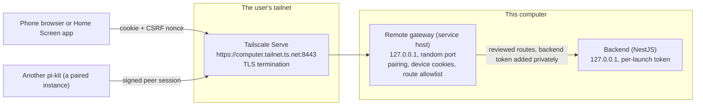
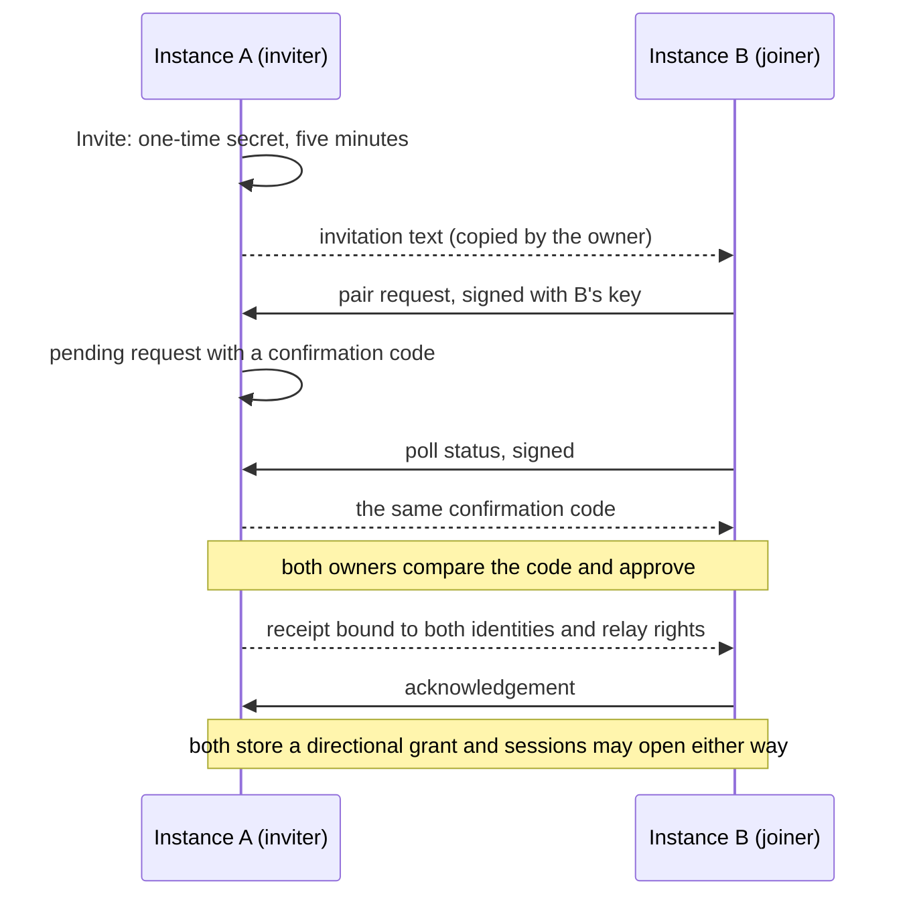

# Remote access

pi-kit can be used from a phone, and one pi-kit can work on the projects of another, without any server in between. The desktop app publishes itself on the user's own [Tailscale](https://tailscale.com) network and nowhere else; a phone or a second computer reaches it only as a member of that tailnet, and only after the owner approved it on the desktop. Nothing is reachable from the public internet, no account exists anywhere, and no traffic passes through pi-kit infrastructure ([ADR-0035](adr/0035-remote-access-over-the-tailnet.md)). The public site at `remote.pi-kit.dev` is only a guide for setting this up ([onboarding site](remote-onboarding-site.md)).

## How it works



1. **Publication is explicit.** Nothing listens until the owner turns on **Settings › Remote access** and chooses a port (on a server: `pi-kit remote enable`). The service host then opens a gateway on a random loopback port and runs `tailscale serve --https=<port> http://127.0.0.1:<gateway port>` in the foreground. Tailscale terminates TLS with the computer's own `*.ts.net` certificate; the gateway sees plain HTTP from the Serve process on loopback only.
2. **The backend never changes.** It keeps listening on loopback with its per-launch bearer token ([ADR-0007](adr/0007-local-security.md)). The gateway is the only client that knows that token, and it adds it to each upstream request after authenticating the caller on its own terms. No backend address or token ever appears in a QR code, a page, browser storage or a phone response.
3. **Devices are approved by the owner.** A phone pairs once with a short-lived code and a six-digit confirmation that must match on both screens. From then on it holds an `HttpOnly` session cookie and fetches a CSRF nonce per page load; both are required on every API call. Approvals are stored in the profile's database and last until the owner revokes them.
4. **Only reviewed routes go through.** The gateway forwards a request only when its path and method are on the allowlist generated from the API contract: routes a controller marks `@Remote()` become `x-remote` in the OpenAPI document and from there the list in `libs/shared/protocol`. Everything administrative, every HTML document and the embedded browser, MCP apps and sandbox routes stay desktop-only.
5. **Instances pair with each other the same way**, with keys instead of cookies. Two computers exchange an invitation, both owners approve the same confirmation code, and from then on each may open short sessions on the other, signed with an Ed25519 key the service host keeps sealed: in the OS keychain, or on a machine without one in an owner-only file (`pi-kit peers key-file --yes`). A phone approved at one computer may use that computer's paired peers through it.

## Connect a phone

1. Install Tailscale on the computer and the phone, sign both into the same tailnet and connect them. Enable HTTPS certificates for the tailnet once in the Tailscale admin console; the setup card in pi-kit links to it and tells the two apart: certificates still missing versus a status check that failed.
2. On the computer open **Settings › Remote access**, choose the **HTTPS port** (default `8443`; port `443` gives a clean address without a suffix) and click **Enable remote access**. The card shows `https://<computer>.<tailnet>.ts.net:<port>` once Serve confirms the mapping.
3. Click **Pair device** and scan the QR code with the phone's camera, or open the address ending in `/phone` on the phone and type the code. Scanning only fills in the code; nothing is requested without the user's tap.
4. On the phone choose **Request access**. Compare the six-digit code with the request shown on the desktop and approve it there. The phone then opens the normal application at the private address.
5. Bookmark the address or add it to the Home Screen. The desktop can revoke each device at any time or disable remote access entirely; disabling disconnects every stream but keeps the approvals for the next time.

On a server without the desktop app, `pi-kit remote enable`, `pi-kit pair` and `pi-kit devices approve <request>` do the same
([Server and CLI](server.md)).

The computer must be awake and pi-kit running; this is remote control of a running desktop, not an always-on service. The phone must be connected to Tailscale, being on the same Wi-Fi is not enough, and the tailnet policy must allow the chosen port. Serve is private to the tailnet; pi-kit never enables Funnel.

### On the Home Screen

In Safari, open the paired address, then **Share › Add to Home Screen** with **Open as Web App** on. The manifest has a stable `/` identity and `standalone` display, so the installed app launches straight into pi-kit. iOS may give the installed app its own cookie jar: if its first launch asks for pairing, pair it once more with a fresh code; that is a second device session, not a lost approval. Changing the HTTPS port changes the saved origin, so the Home Screen entry has to be added again.

There is no offline cache of conversations, files or pairing pages, on purpose: revocation on the desktop must take effect immediately, and the computer has to be reachable anyway.

### What a phone can do

Chat in existing and new threads, answer questions and approvals, pick models, browse files, review and edit changes, use the terminal and dictate with a configured voice model. Installing providers or models, credentials, app updates, trusting projects, computer use and other machine-level settings stay on the desktop, and Settings on a phone does not list those sections at all; configure providers and voice models there first. This is trusted remote control of the owner's agent, files and shell. It is not a way to share an agent with someone else: tailnet membership alone grants nothing, and there is no per-user isolation behind an approved device.

## Environments and paired instances

An **environment** is one pi-kit instance: a stable UUID created on first start and a display name the owner can edit in **Settings › Environment**. Names are labels for people and never routing keys. The model is environment → project → thread:

- A project belongs to exactly one environment, with its folder, trust, settings and worktrees there.
- A thread inherits its project's environment for good. Opening another environment's project never retargets running work and never copies transcripts or files.
- With a single environment nothing changes: no naming step, no key, no switch in the sidebar.



Pairing is reciprocal and explicit. On the inviting computer, **Settings › Environment › Paired instances › Invite** produces an invitation that is valid for five minutes; the other owner pastes it under **Connect**. Each side signs every step with its instance key and checks the other's published identity (UUID, origin and key fingerprint) against what it pinned at pairing, so a replaced key or a moved origin means pairing again, never a silent reconnect. Both owners see and approve the same six-digit code, and each chooses whether its approved phones may relay through this pair. Unpairing takes effect locally at once and notifies the peer when it is reachable; a pair that was revoked cannot be reactivated without a new invitation.

Once paired, the sidebar's environment switch at the bottom lists both instances and the projects each knows. Choosing a project of the other instance reloads the workbench against it: the entry instance proxies the reviewed API to its peer over a short-lived signed session, the peer checks every request again, and the current environment is shown on the switch and in the Settings header so it is always clear whose files are being edited. Composer text that would be lost by a switch is confirmed first.

A phone follows the same rule one hop deep: a device approved at instance A may use A's directly paired peers through A, when A's owner allowed relaying for that pair. It never reaches a peer of a peer, and it never talks to the peer directly.

## Security model

- **Pairing code**: 12 random Base32 characters, five-minute expiry, consumed once. It travels in the URL fragment, is removed from the address bar immediately and is submitted only when the user requests access.
- **Pending request**: its own high-entropy `HttpOnly` cookie, two-minute expiry, a six-digit confirmation code and explicit desktop approval. Approval is never inferred from Tailscale identity headers.
- **Approved device**: a fresh random session cookie of which only the SHA-256 hash is stored, `__Host-`, `Secure`, `HttpOnly`, `SameSite=Strict`, with a renewable browser lifetime of up to 400 days; the approval itself has no cutoff. API calls also need the device's CSRF nonce.
- **Limits**: twenty pending requests and twenty devices, rate-limited pairing attempts and status polls, bounded bodies. Revocation, expiry and disabling abort every stream of that device.
- **Host and origin**: the gateway accepts loopback connections only, requires the exact public `Host`, and requires the public `Origin` on every mutating request.
- **Upstream**: a literal loopback HTTP URL. Browser cookies, authorization and forwarding headers are stripped, the backend token is added privately, and upstream cookies, CORS headers, redirects and executable document types are blocked on the way back.
- **Static files**: realpath-confined to the packaged renderer. No traversal, no symlinks outside the root, no source maps, no hidden paths, no arbitrary HTML.
- **Content Security Policy**: scripts and connections from the same origin only, no framing or object embedding; the only page that may use the camera is the unauthenticated pairing page.
- **Instance keys**: an Ed25519 key per profile, generated on the first invitation, sealed with the OS keychain (Electron `safeStorage`; on Linux only a real keyring backend is accepted, never the plaintext fallback) and never written in the clear. Proofs are JWTs with a 30-second lifetime bound to the peer, the purpose, a nonce and the pair's identities. A key that cannot be unsealed stops pairing with a clear message; it is never replaced behind the owner's back.

## Tailscale lifecycle

The desktop finds an installed Tailscale CLI, including the one inside the macOS app bundle, and calls it with argument arrays, never through a shell. Every subprocess gets `TAILSCALE_BE_CLI=1` in its own copied environment, because the bundled executable otherwise starts in GUI mode when launched from Finder without a shell's `SHLVL`; nothing in the user's environment or Tailscale configuration changes.

Opening Settings only reads status. Publication is the foreground `tailscale serve` above: the app first checks that nothing else listens on the chosen port, verifies after starting that the HTTPS mapping points at its own gateway, and reports ready only then. It never runs `up`, `down`, `funnel`, `reset` or a persistent `--bg` session. Stop and quit end the foreground process and close the gateway without touching the VPN. If the daemon keeps a mapping after that, the app names that mapping for manual review instead of deleting a listener it might not own. Enable and the chosen port are remembered per profile; a restart resumes access only if it was on, and never for a fresh profile.

## Troubleshooting

| Symptom | Cause and fix |
|---|---|
| "Setup needed" with an HTTPS link | The tailnet has no HTTPS certificates yet. Enable them in the admin console (an admin may need to approve), then **Check again**. |
| "Tailscale opened in app mode" | The CLI answered as the GUI. This is a pi-kit integration issue, not missing approval; report it with the Tailscale version from the details. |
| Port already configured | Something else, perhaps Funnel, uses the port in Serve. Pick another port or remove that mapping in Tailscale; pi-kit never overwrites it. |
| Retained mapping after stop | Serve kept the previous session. Review and remove exactly that mapping in Tailscale before starting again. |
| Phone shows the pairing page again | The session cookie is gone (site data cleared, a reinstalled Home Screen app) or the device was revoked. Pair again. |
| The other environment shows "offline" | Its computer is asleep, its remote access is off, or its key or origin changed. Nothing is redirected elsewhere; wake it or pair again. |
| Instance key unavailable | The OS keychain could not unseal the key. Unlock it or restore the key; pi-kit does not create a replacement identity. |

## Validation

- Desktop unit tests cover the gateway (pairing, codes, approval, rejection, expiry, cookie and nonce requirements, route policy, static confinement, streaming and revocation), the Tailscale lifecycle with a fake CLI, the key store and the IPC surface.
- Backend tests pair two in-memory instances through every step, including restarts, offline peers, replaced keys and unpairing from either side.
- Renderer tests cover the phone transport, the settings sections and the environment switch.
- `e2e/remote-access.desktop.e2e.mjs` drives a real iPhone-sized Electron browser through pairing and use against the production frontend and an isolated backend behind a loopback TLS proxy; `e2e/instances.desktop.e2e.mjs` pairs two isolated instances the same way and checks relayed reads and revocation.
- `node e2e/support/tailnet-pair-fixture.mjs 8444,8445` publishes two isolated instances through the connected Tailscale for manual testing on a real device and writes their addresses and a control endpoint to `tmp/tailnet-fixture/state.json`. `e2e/support/phone-preview-server.ts` does the same for one instance without a tailnet.

```sh
pnpm exec nx run-many -t build -p renderer,backend
node --test e2e/remote-access.desktop.e2e.mjs e2e/instances.desktop.e2e.mjs
```

## References

- https://tailscale.com/kb/1312/serve
- https://tailscale.com/kb/1153/enabling-https
- https://tailscale.com/kb/1065/macos-variants
- https://github.com/tailscale/tailscale/blob/main/ipn/ipnlocal/serve.go
