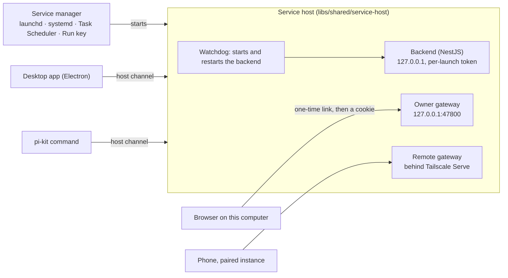

# Server and CLI

pi-kit is a server with clients. A **service host** runs the backend and outlives any window; the desktop app, a browser on
the same computer and paired phones are clients of it, and the `pi-kit` command manages it. The desktop installers and the
server installs ship the same server ([design](https://github.com/Soverius-AI/pi-kit/blob/main/doc/designs/headless-cli-server.md),
[ADR-0036](adr/0036-always-on-service.md)).



- **One host per profile.** The profile is the data folder; the host that owns it writes `service.json` there, which says
  where its **host channel** is (a socket, or a named pipe on Windows) and the token a client presents to enter it. A second
  host for the same folder refuses to start.
- **The host's level** says who started it: `login` (the operating system's service), `app` (the desktop app, with the
  service off; it ends with the app) or `serve` (`pi-kit serve`, in a terminal or a container).
- **The desktop app is a client.** It attaches over the host channel, gets the backend's address and token, and answers the
  backend's requests for what only Electron can do. When the service moves (a restart, an update, another install taking
  over), the app restarts onto the next host.
- **A browser** gets the full UI through the owner gateway: `pi-kit open` makes a one-time link, which sets an owner cookie.
- **Phones and other instances** reach the remote gateway over the tailnet ([Remote access](remote-access.md)).

## Installs

| Install | Get it | Runs on | Updates |
|---|---|---|---|
| Desktop app | the release's `.dmg`/`.zip` (macOS, Apple Silicon), `.exe` (Windows x64, arm64), `.AppImage` (Linux x64, arm64) | Electron, as Node for the host | the app's own updater |
| Server archive | the release's `pi-kit-server-<version>-<target>.tar.gz`, `.zip` on Windows, checked against `SHA256SUMS` | its own Node 24 in `runtime/` | `pi-kit update` |
| npm | `npm install -g @soverius-ai/pi-kit` | the platform package's own Node 24; the launcher needs Node 18 or later | `pi-kit update`, which runs npm |

npm installs only the package for the machine, `@soverius-ai/pi-kit-<os>-<arch>` for darwin, linux and win32 on arm64 and
x64. On a server install, `pi-kit desktop install` adds the desktop app of the same version: it downloads it from the
release, checks it against the sha512 the app's updater trusts, installs it for this user and starts it.

**One machine, several installs.** They share the profile, and **the newest install runs the service**. An older install's
`pi-kit service install` changes nothing and names the newer one. The desktop app, at each start, becomes the newer version
the service runs first, attaches to a service of its own version, and registers itself otherwise.

## The service

| | Starts at sign-in | Starts at boot, with nobody signed in |
|---|---|---|
| macOS | LaunchAgent | LaunchDaemon that runs the host as its owner: `pi-kit service install --level boot` (asks for the password) |
| Linux | systemd user unit | the same unit, with `loginctl enable-linger` |
| Windows | the desktop app: a `Run` key and a windowless supervisor | a server install: a Task Scheduler task (asks for the account password once) |

**Settings › General › Background** in the app does what `pi-kit service install` and `uninstall` do. The host restarts its
backend after a crash; launchd, systemd and the Windows supervisor restart the host.

## A server, step by step

```bash
npm install -g @soverius-ai/pi-kit   # or unpack a server archive and run its bin/pi-kit
pi-kit service install               # start the backend at sign-in, and now
pi-kit login                         # sign in to a model provider
pi-kit open                          # the full UI in this computer's browser
pi-kit remote enable                 # publish it on your tailnet
pi-kit pair                          # pair a phone
```

Over SSH, `pi-kit open` prints the link and the `ssh -L` forward that reaches it from your own computer.

## Commands

`pi-kit --help` prints all of them.

| Command | What it does |
|---|---|
| `pi-kit service status` | whether the service is installed and running; exit code 3 when it is not; `--json` for scripts |
| `pi-kit service install` | start the backend at sign-in, and now; `--level boot` on macOS: at boot |
| `pi-kit service uninstall` | stop it and no longer start it |
| `pi-kit service start`, `stop`, `restart` | start, stop or restart it |
| `pi-kit service logs` | the end of `service.log`, and where the logs are |
| `pi-kit serve` | run the host in this terminal, for a container or another supervisor |
| `pi-kit update [--check]` | update a server install: a server archive is checked and swapped in place, an npm install is updated with npm |
| `pi-kit login [<provider>]` | sign in to a model provider (`--api-key` or `--oauth` where it offers both) |
| `pi-kit login --local <url>` | add a local model server (llama.cpp, llama-swap, Ollama, any OpenAI-compatible one) |
| `pi-kit logout <provider>` | remove a provider's stored sign-in |
| `pi-kit model [<provider>/<id>]` | show or set the default model for new threads |
| `pi-kit open` | start the installed app, or open the browser with a one-time link; `--browser` for the browser; `--revoke` signs every browser out |
| `pi-kit desktop install` | download, check, install and start the desktop app of this server's version |
| `pi-kit remote status`, `enable [--port N]`, `disable` | publish pi-kit on your tailnet with Tailscale Serve |
| `pi-kit pair` | a pairing link and QR code for a phone |
| `pi-kit devices` | paired devices and waiting requests; `approve`, `reject`, `revoke` |
| `pi-kit peers` | this instance, its paired instances and waiting requests; `invite`, `connect`, `approve`, `reject`, `unpair` |
| `pi-kit peers key-file --yes` | seal the instance key with an owner-only file, for a machine without a keychain |

## Where things are

| | macOS | Linux | Windows |
|---|---|---|---|
| Profile (data folder) | `~/Library/Application Support/pi-kit` | `~/.config/pi-kit` | `%APPDATA%\pi-kit` |
| Logs | `~/Library/Logs/pi-kit` | `~/.config/pi-kit/logs` | `%APPDATA%\pi-kit\logs` |

`PI_KIT_DATA_DIR` points a command or a host at another profile. In the logs, `service.log` is the host,
`backend.log` the backend, `main.log` the desktop app, `supervisor.log` the Windows supervisor and `update.log` the
updates.
